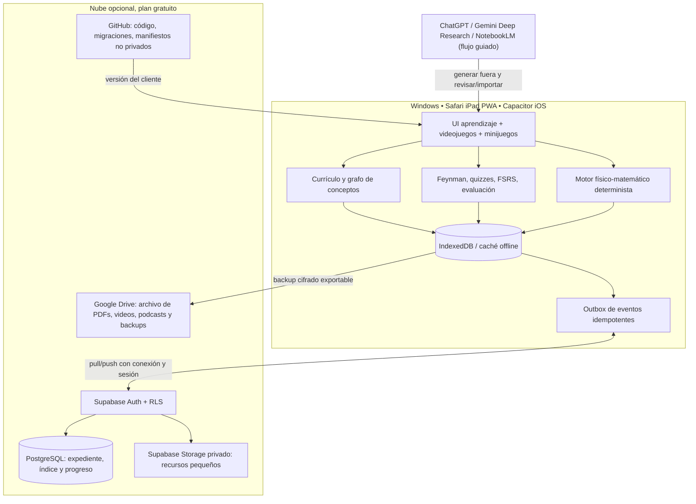
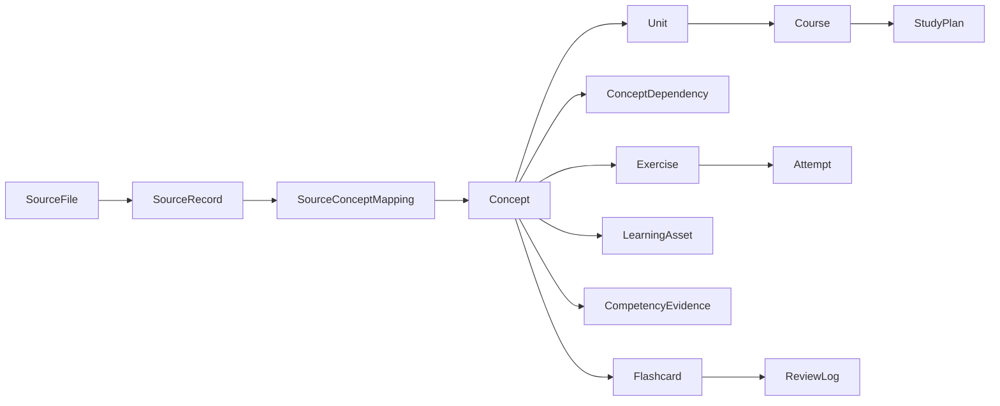
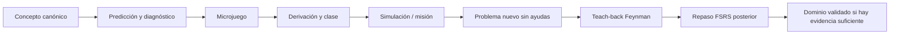

# ACADEMIA CIENTÍFICA IA — Arquitectura maestra v2.0: videojuegos y nube híbrida

> **Especificación técnica, pedagógica, visual y de ingeniería de prompts.**  
> **Modalidad:** aplicación personal, un solo usuario, *local-first con sincronización cloud opcional*, presupuesto monetario objetivo **0 MXN/mes**.  
> **Disciplinas:** Física, Matemáticas, Química, Ingeniería y conexiones interdisciplinarias.  
> **Plataformas:** desarrollo inicial Windows → repositorio GitHub → Mac/Xcode → iPadOS.  
> **Fecha de diseño:** 21 de octubre de 2026; **revisión v2:** 21 de octubre de 2026.  
> **Estado:** arquitectura propuesta y ampliada, NO aplicación desplegada, NO cuenta cloud creada, NO currículo científicamente certificado.

---

## 0. Mandato del producto

**Misión.** Construir el sistema personal de aprendizaje científico más exigente, disfrutable, trazable, configurable y profundo que resulte factible con recursos gratuitos. Su norte no será consumir contenido, ganar puntos o completar vídeos: será **demostrar comprensión, retenerla y transferirla a problemas nuevos**, sin sacrificar precisión matemática, rigor físico, experimentación ni creatividad.

**Invariantes no negociables:**

1. **No perder contenido fuente.** Ningún identificador de origen se elimina; una equivalencia semántica une registros, no los borra.
2. **No fingir conocimiento ni verificación.** Diferenciar contenido documental, hipótesis, ampliación propuesta, resultado calculado y material aprobado.
3. **No afirmar que un dibujo físicamente incorrecto es una simulación.** Las visualizaciones explicativas se etiquetan como ilustraciones; las simulaciones provienen de modelos explícitos, parámetros, unidades y pruebas.
4. **No depender de un chat infinito.** El progreso, currículo, evidencias y estado de revisión se almacenan en la app y, si se configura, se sincronizan con Supabase; los modelos externos son colaboradores opcionales.
5. **Costo operativo cero por defecto.** Solo servicios con plan sin costo, sin método de pago ni cambio automático a planes de facturación; si un cupo se agota, degradar a modo local y copias manuales.
6. **iPad como dispositivo principal de estudio** y Windows/Mac como estaciones para desarrollo, generación de animaciones pesadas y bibliografía.
7. **Aprendizaje paralelo real.** Un grafo de requisitos habilita varias rutas simultáneas sin confundir frentes topológicos con semestres ni imponer avanzar materia por materia.
8. **Pedagogía dual:** rigor doctoral cuando procede + explicaciones intuitivas y memorables; analogías atractivas acompañadas de sus límites de validez.
9. **Una persona, no una red social.** Sin publicidad, ranking social, monetización, cuentas de terceros dentro de la app ni mecánicas de culpa por interrumpir una racha.
10. **El sistema debe ser auditable.** Se registran cambios, procedencia, versión del motor de evaluación y evidencia de cada competencia dominada.
11. **Juegos con ciencia real.** El entretenimiento nunca altera ecuaciones ni enseña una aproximación como si fuera una ley universal.
12. **Al menos dos soportes independientes de los datos críticos.** Nube + exportación local externa y restauración comprobada; proveedor gratuito no equivale a backup garantizado.

### 0.1. Qué significa realmente «costo cero»

- **Sí:** frameworks libres, ejecución en tu equipo, GitHub Free, PWA, almacenamiento local, libros de acceso abierto, vídeos/áudios generados manualmente en los cupos gratuitos de los servicios a los que ya accedes.
- **No se promete:** uso ilimitado de Gemini, NotebookLM, ChatGPT ni sus APIs; generación automática desatendida en plataformas personales sin API; disponibilidad ininterrumpida de Supabase Free ni sincronización fuera de línea; firma iOS permanente gratuita mediante Xcode.
- **Compensación deliberada:** algunas tareas con IA funcionarán **asistidas por copiar/pegar, importar/exportar o abrir la herramienta externa**, mientras el estudio diario, evaluaciones deterministas, flashcards y laboratorios locales no dependen de cuotas ajenas.
- **No es un costo cero absoluto de recursos:** internet, electricidad, equipos, almacenamiento y tiempo sí tienen un costo real; **0 MXN/mes** es el objetivo de gasto nuevo por software/hosting/API.

### 0.2. Insumos curriculares reales y líneas base

El currículo maestro v5 que ya posees contiene:

| Indicador | Base auditada v5 | Interpretación correcta |
|---|---:|---|
| Asignaturas | **307** | 303 originales + 4 propuestas anteriores |
| Relaciones entre materias | **540** | Grafo declarado, acíclico; no equivale a auditoría subtemática |
| Frentes topológicos | **14** | Conjuntos habilitables con independencia declarada, no períodos de igual duración |
| Temas originales del Excel | **3,695** | Registros literales preservados |
| Epígrafes TECH | **3,313** | Preservados, con equivalencias semánticas aún por validar |
| Líneas temáticas originales UdeG | **1,609** | Preservadas; su vista didáctica reconstruida tiene 1,421 registros, **no se suma otra vez** |
| Ampliaciones v5 | **520** | Propuestas específicas, en 52 módulos |
| Inventario sin deduplicar | **9,137** | Suma de registros de origen y propuestas; **no** implica 9,137 conceptos diferentes |
| Alertas de auditoría | **112** | A revisar sin ocultarlas |

**Archivos de arranque recomendados:** `Academia_FISICA_v5_catalogo_integro.json` (fuente de importación), `Plan_Maestro_Academia_FISICA_v5_integral.xlsx` (revisión humana), `FISICA_v5_manifiesto_integridad.json` (hashes y conteos), `Dictamen_Academia_FISICA_v5.md` (límites conocidos) y los PDF originales de TECH/UdeG conservados localmente. No subir libros protegidos por derechos de autor a un repositorio público.

**Política de ampliación:** no existe «el plan más extenso del mundo» como propiedad certificable aquí. El sistema debe ser **extensible sin techo artificial**, auditar lagunas con referentes universitarios y registrar cada incorporación como `propuesta_externa` hasta su aprobación. Evitar cursos llamados «Tópicos selectos» sin contenidos concretos.

---

## 1. Decisión arquitectónica: PWA primero, iPad nativo después

### 1.1. Por qué esta decisión

Una aplicación puramente nativa en SwiftUI complicaría la fase de Windows y duplicaría código de visualización científica. Una PWA con tecnología web moderna permite construir **una sola interfaz** en Windows, ejecutarla en Safari del iPad, instalarla en la pantalla de inicio, utilizarla sin conexión una vez cacheada y, cuando sea necesario, empaquetarla con **Capacitor** para compilar en Xcode.

**Ruta de despliegue recomendada:**

1. **Windows:** Node LTS + pnpm + VS Code/Cursor u otro editor que ya poseas; desarrollo local `localhost`.
2. **GitHub:** repositorio de código y documentación. Separar estrictamente el código público de datos personales y material de terceros.
3. **Publicación gratuita opcional:** GitHub Pages desde repo **público** para el *shell* estático, **sin** currículos o ficheros de contenido con licencias restrictivas embebidos. Importar el currículo localmente desde archivo al abrir la app.
4. **iPad inmediato:** Safari → Compartir → Añadir a pantalla de inicio → Abrir como app web. **No necesitas Xcode para esto.**
5. **Mac posterior:** Git clone → pnpm install → pnpm build → Capacitor sync → abrir en Xcode → ejecutar en tu propio iPad.
6. **Firma gratuita:** Apple Personal Team permite probar apps, pero los perfiles expiran a los **7 días**, por lo que se requiere reinstalación/reaprovisionamiento periódico. Usar **PWA** para un acceso continuo gratuito.

**Importante sobre offline:** el primer uso requiere descargar la aplicación y sus recursos; Safari puede desalojar almacenamiento local por presión de espacio. Por eso el sistema deberá exportar copias de seguridad frecuentes, ofrecer importación y mostrar salud de almacenamiento.

### 1.2. Arquitectura global v2 (almacenamiento local + nube + biblioteca multimedia)



**Distinción de autoridad y retención:** la base local conserva la capacidad de estudiar offline; Postgres conserva el expediente sincronizado cuando el servicio está disponible; Drive constituye archivo y backup deliberados, **no** una integración automática de NotebookLM/Gemini. El catálogo canónico tiene versión y checksum, y la base de datos solo contiene datos estructurados y referencias a archivos. El repo Git nunca lleva notas personales ni PDFs de terceros en una rama pública.

**No prometer sincronización perfecta al desconectar:** toda escritura entra primero en una cola local durable; se confirma en la nube y se marca como sincronizada solo después del acuse del servidor. La aplicación nunca borra la última copia local por la ausencia de conexión.

### 1.3. Planes tecnológicos elegidos (sin suscripción adicional)

| Capa | Elección principal | Alternativa / condición |
|---|---|---|
| Frontend | **React + TypeScript + Vite** | SPA estática, sin backend requerido |
| Navegación | React Router | Rutas tipadas y estados compartibles |
| UI base | Tailwind CSS + shadcn/ui + Radix | Componentes accesibles, todos versionados |
| Iconografía | Lucide | SVG locales; no depender de CDN |
| Estado de interfaz | Zustand o React Context | Estado efímero, **no** expediente académico |
| Base local | **IndexedDB + Dexie** | IndexedDB es la primera escritura durable; cola de sincronización y material offline |
| Validación de contratos | Zod | Validar importaciones, prompts, resultados y migraciones |
| Gráficos | Plotly.js o Apache ECharts | Elegir por prueba de rendimiento táctil; uso SVG/Canvas |
| Diagramas | Mermaid, SVG + React Flow | Excalidraw integrado como lienzo opcional |
| Matemáticas | KaTeX + MathLive | TeX fiable y editor táctil de fórmulas |
| Animaciones | Canvas 2D / SVG / Web Animations / p5.js | Three.js cuando realmente se necesita 3D |
| Laboratorio código | CodeMirror 6 + **Pyodide en Web Worker** | JupyterLite opcional; notebook de escritorio para proyectos pesados |
| Repaso espaciado | **ts-fsrs** | Algoritmo auditable, guardando logs por tarjeta |
| Archivos educativos | Markdown + JSON + SVG + WebM/MP4 + PDF | Quarto/LaTeX/Manim fuera del iPad para generación pesada |
| Pruebas | Vitest + Testing Library + Playwright | Tests visuales, integración y verificaciones matemáticas |
| Distribución PWA | GitHub Pages para shell público | Repo personal privado + distribución local alternativa |
| iPad wrapper | **Capacitor iOS** | Compilación en macOS/Xcode cuando el usuario quiera |
| Sincronización opcional | **Supabase Free (Auth + Postgres + RLS)** | Servidor solo de datos; modo offline completo ante pausa/cupo |
| Objetos pequeños | **Supabase Storage privado** | 1 GB gratuito compartido a nivel de proyecto; acceso RLS |
| Archivo multimedia / backups | **Google Drive personal** | Cuota compartida hasta 15 GB; carga guiada, no ilimitada |
| Backups | Exportación ZIP/JSON cifrada con AES-GCM | Restauración probada con hashes; copia también en Windows/Mac |

**No usar en la primera versión:** planes Blaze/Pro, Vercel Functions de pago, backend Node permanente, Kubernetes, APIs LLM pagadas, agentes que copien cookies de Gemini/NotebookLM o credenciales expuestas. **Supabase Free sí está aprobado como sincronizador opcional**, configurado después de un MVP local funcional. No exigir cloud para iniciar la app ni para completar juegos/ejercicios.

**Comparación oficial de planes (consulta 21-10-2026; reconfirmar antes de contratar):**

| Criterio | Supabase Free | Firebase Spark | Decisión |
|---|---|---|---|
| BD gratuita | PostgreSQL 500 MB | Firestore 1 GiB | Supabase por relaciones curriculares y SQL |
| Almacenamiento de archivos | 1 GB Storage | Cloud Storage de proyectos nuevos no está incluido en Spark según tabla oficial | Supabase para recursos ligeros |
| Cuota de uso | 5 GB egreso mensual y pausa tras ~7 días de inactividad | Firestore 50k lecturas/día, 20k escrituras/día | Local-first reduce ambas presiones |
| Facturación | No activar Pro/add-ons | No activar Blaze ni asociar cuenta de facturación | Limitarse a Free/Spark |
| Automatización/backup | Backups automáticos no incluidos en Free | Backup nativo Firestore fuera de cuota gratuita | Exportaciones propias comprobadas |
| Biblioteca grande de medios | 1 GB es insuficiente para archivo audiovisual voluminoso | No seleccionada | Drive privado y PC/Mac como archivo frío |

Fuentes: https://supabase.com/pricing ; https://supabase.com/docs/guides/platform/free-project-pausing ; https://firebase.google.com/pricing ; https://cloud.google.com/firestore/pricing ; https://supabase.com/docs/guides/platform/backups ; https://support.google.com/drive/answer/9312312


---

## 2. Arquitectura de datos y garantía de no pérdida

### 2.1. Tres capas curriculares separadas

1. **Fuente inmutable (`source_records`).** Transcripción original con texto exacto, archivo, hash, sección, página, identificación y origen `Excel / TECH / UdeG / Propuesta_v5`.
2. **Catálogo canónico editable (`concepts`, `units`, `courses`).** Conceptos enseñables normalizados que pueden agrupar varias referencias fuentes. `source_to_concept` es **muchos-a-muchos**.
3. **Perfil personal (`attempts`, `mastery`, `review_cards`, `artifacts`).** Ejercicios, puntuaciones, intervalos FSRS, notas y errores. Puede resetearse sin eliminar contenido ni fuentes.

No sumar a la fuerza los 1,421 temas derivados UdeG al inventario literal de 9,137, pues son una segunda vista de sus 1,609 líneas. Conservar ambas vistas y su vínculo.

### 2.2. Esquema conceptual de entidades



**Entidades mínimas con campos obligatorios:**

- `SourceFile(id, name, sha256, bytes, sourceType, copyrightStatus, localPath?, importedAt)`.
- `SourceRecord(id, sourceFileId, locator, rawText, rawNumber?, row?, page?, parentId?, sha256, originVersion)`.
- `Concept(id, canonicalTitle, definition?, discipline, difficultyBand, status, scientificDomain, validityConditions, canonicalOrder?)`.
- `SourceConceptMapping(sourceRecordId, conceptId, relation: exact|equivalent|partial|related|conflict|unmapped, confidence, reviewer, evidence, approvedAt?)`.
- `Course(id, title, discipline, goal, estimatedHours?, sourceOrigin, stageLabel, educationalLevel, officialStatus)`.
- `Unit(id, courseId, title, position, description, status)`.
- `ConceptDependency(fromConceptId, toConceptId, kind: hard|recommended|co-requisite, rationale, reviewStatus)`.
- `Exercise(id, conceptIds[], type, statement, seed?, validatorSpec, solution, rubric, testCases, citations[], status)`.
- `LearningAsset(id, conceptIds[], kind, fileRef, sourceIds[], version, reviewStatus, checksum, license, limitations)`.
- `Attempt(id, exerciseId, timestamp, submittedAnswer, grade, rubricBreakdown, feedback, evaluatorVersion)`.
- `Mastery(conceptId, evidenceIds[], state, lastAssessedAt, transferScore?, uncertainty)`.
- `Flashcard(id, conceptId, front, back, cardKind, validationStatus, fsrsData, sourceRefs[])`.
- `ReviewLog(cardId, dueAt, reviewedAt, rating, latency?, feedback)`.
- `ResearchFinding(id, query, link, doi?, license, claim, evidencePages[], sourceType, verifiedAt?, reviewer)`.
- `StudySession(id, duration, topicIds[], activities[], outcomes[], selfReflection, startedAt, endedAt)`.
- `Achievement(id, ruleVersion, evidenceIds[], unlockedAt)`.
- `ChangeLog(timestamp, actor, target, beforeHash, afterHash, rationale, source)`.

### 2.3. Ejemplo de contrato canónico JSON (ilustrativo)

```json
{
  "id": "CONCEPT.FIS.OPTICA.REFRACCION.SNELL",
  "canonicalTitle": "Ley de Snell y refracción en medios isotrópicos",
  "discipline": "fisica",
  "status": "pendiente_revision_cientifica",
  "sourceRecords": ["SOURCE_RECORD_ID_1", "SOURCE_RECORD_ID_2"],
  "prerequisites": [
    {"id": "CONCEPT.FIS.ONDAS.FASE", "kind": "hard"},
    {"id": "CONCEPT.MAT.TRIGONOMETRIA", "kind": "hard"}
  ],
  "objectives": [
    "Derivar la ley mediante continuidad de fase",
    "Calcular direcciones refractadas con unidades y supuestos"
  ],
  "validity": ["óptica geométrica", "interfaz plana", "medios isotrópicos"],
  "assets": [],
  "rubricId": "RUBRIC.PHYSICS.V1"
}
```

**Importante:** estos IDs del ejemplo son ilustrativos; **no** deben reemplazar ni confundirse con los IDs reales del catálogo v5.

### 2.4. Invariantes ejecutables del importador

```text
assert unique(rawRecord.id)
assert count(raw_excel) == 3695
assert count(raw_tech) == 3313
assert count(raw_udeg) == 1609
assert count(proposed_v5) == 520
assert total_raw_records == 9137
assert count(courses_v5) == 307
assert count(course_edges_v5) == 540
assert graph(course_edges_v5).isDAG()
assert set(ids_importados) == set(ids_manifiesto)
assert sha256(archivos_originales) == manifiesto_esperado
assert every_source_record_has_mapping_OR_open_review_ticket
assert no_approved_concept_without_source_or_explicit_external_proposal
```

Los conteos deben validarse **contra un manifiesto versionado**, no codificarse eternamente: futuras incorporaciones producirán una nueva versión y nuevos valores de referencia. Ninguna fusión conceptual puede suprimir un `SourceRecord`.

### 2.5. Migraciones, integridad y copias

- Importación de `v5.json` en lotes y transacciones IndexedDB. Mostrar contador y resúmenes por disciplina.
- `schemaVersion`, `curriculumVersion`, `importId`, `manifestSha256`, `migratedAt` en toda copia.
- **Migraciones reversibles cuando sea posible:** conservar copia anterior, comprobar hashes, revertir si falla una importación.
- Backups incrementales cuando tengan sentido + backup completo antes de importar nuevo plan; restauración con vista previa y conflictos.
- **Sin fusión automática destructiva**: un mapa de equivalencias requiere doble confirmación documental/científica.
- Guardar metadatos de derechos/licencias y no redistribuir PDFs propietarios en Pages ni en paquetes públicos.
- Exportar e importar `academybackup` por Archivos/AirDrop/iCloud Drive/manual; cifrar cuando contenga respuestas, notas o archivos personales.

---

## 2A. Persistencia permanente, sincronización y almacenamiento (ADR obligatorio)

### 2A.1. ¿Dónde vive **todo** el contenido?

**Regla de tres niveles:** cada recurso tiene un registro canónico (identificador + metadatos + SHA-256), una ubicación primaria apropiada para su tamaño y al menos una posibilidad de exportación o copia secundaria. Ningún plan gratuito ofrece retención o espacio ilimitado; el sistema debe mostrar cuánto almacenamiento disponible queda y avisar **antes** de superar un límite.

| Clase de información | Primario de trabajo | Réplica/archivo | Política |
|---|---|---|---|
| 9,137 registros fuente v5 y mapa canónico | IndexedDB; tabla/objetos versionados en Supabase | JSON original en Windows/Mac y backup privado Drive | Inmutabilidad, hash de fuente y audit trail |
| 307 materias, DAG, 520 propuestas y sus revisiones | IndexedDB ↔ Supabase Postgres | Archivo curricular privado versionado, según licencias y permisos | Migración aditiva; no sustituir fuente |
| Notas, Feynman, respuestas, dominio, errores | IndexedDB ↔ Supabase Postgres | Backup personal cifrado en Drive + ordenador | RLS por usuario; no incluir en Git público |
| Revisiones FSRS, rachas, logros y partidas | Eventos locales ↔ Supabase Postgres | Backup del expediente | Evento único e idempotente |
| Quizzes, fichas, enunciados, rúbricas y soluciones | Packs JSON/MD+assets en local/Storage/Drive | Versiones firmadas con hash | Versión evaluadora inmutable por intento |
| SVG, diagramas, mapas y código de simulación | Paquete local o Storage de poco peso | Código reproducible en Git; backup privado cuando aplique | Ciencia verificada + licencia |
| Vídeos, audio, PDF extensos, capturas y cuadernos | Carpeta privada Drive + caché seleccionada en dispositivos | Original en disco Windows/Mac | Descarga opcional; no subir automáticamente todo a Supabase |
| Bibliografía externa de pago | Metadatos y enlace autorizado | Referencia, no redistribución | Derechos de autor y atribución |
| Exportación total | Archivo cifrado `academybackup` y manifiesto | Drive + carpeta local `backups/` | Restauración ensayada, no depender del dashboard cloud |

**Capacidad real:** Supabase Free publica BD **500 MB**, **1 GB** para archivos y un máximo de **50 MB por archivo** en Storage Free; Drive personal publica hasta **15 GB** compartidos con Gmail y Fotos. Miles de vídeos pueden exceder esas capacidades; almacenarlos en disco ya disponible, enlaces externos legales y sincronización selectiva de contenidos prioritarios. **No prometer que todos los medios futuros residirán simultáneamente en una sola nube gratuita.**

### 2A.2. Diseño de sincronización para un único usuario, dos dispositivos

1. **Autenticación opcional** mediante Supabase Auth con correo/contraseña o enlace de acceso, sujeto a sus límites. Una sola cuenta propia, sin funciones multiusuario.
2. **Escritura local primero**: transacción Dexie almacena intento o partida + evento `sync_outbox` con UUID de evento, `device_id`, versión y hash del contenido.
3. **Sincronización por lotes**: enviar eventos en orden causal cuando haya conectividad y autenticación válida; `upsert` de identificadores inmutables para garantizar idempotencia.
4. **Descarga incremental**: consultar cambios posteriores a un cursor lógico del servidor; nunca usar únicamente la hora del móvil como criterio de orden, por desajustes de reloj.
5. **Conflictos**: respuestas e intentos se agregan, no se sobrescriben; notas se conservan como versiones paralelas o requieren fusión asistida; FSRS se recalcula sobre revisiones deduplicadas en orden determinista.
6. **Confirmación**: solo pasar de `pending` a `synced` tras ACK de servidor y hash. Reintentar con retroceso exponencial; mostrar errores entendibles, no mensajes de éxito ficticios.
7. **Reposo/pausa Supabase**: modo offline total y banner «Nube temporalmente no disponible»; intentar reactivar desde el panel y sincronizar posteriormente. Según la documentación publicada, la ventana de restauración de un proyecto pausado llega hasta **un año**; no es garantía de almacenamiento perpetuo. No emplear peticiones ficticias o bots para eludir normas de inactividad.
8. **Exportar/restaurar**: ofrecer backup antes de migraciones, copia de seguridad manual y restauración con verificación de todos los IDs y SHA.

**Relación entre copias**: no elegir un único «último dispositivo» que pueda borrar trabajo del otro. El servidor reconcilia el log de eventos confirmados; el índice materializado de dominio puede regenerarse del log auditable.

### 2A.3. Datos SQL recomendados y control de acceso

Entidades cloud iniciales: `profiles`, `curriculum_releases`, `source_records`, `concepts`, `concept_source_map`, `concept_edges`, `content_assets`, `lessons`, `exercise_templates`, `attempts`, `mastery_events`, `review_events`, `game_definitions`, `game_sessions`, `game_events`, `achievements`, `research_sources`, `notes_versions`, `sync_receipts`, `backup_manifests`.

Usar UUID para eventos; el identificador del concepto curricular es estable, no un contador que cambia al importar. Registrar `owner_id`, `created_at`, `schema_version`, `curriculum_version` y `content_sha256` donde corresponda. Separar `game_definition` (reglas y validadores) de `game_session` (instancia con parámetros, semilla, motor y resultado).

**Política RLS tipo; debe verificarse por tabla, incluyendo Storage:**

```sql
-- EJEMPLO de tabla privada (requiere migración revisada y permisos mínimos).
create table if not exists public.game_sessions (
  id uuid primary key,
  owner_id uuid not null references auth.users(id) on delete cascade,
  game_id text not null,
  game_version text not null,
  simulation_version text not null,
  seed bigint not null,
  result jsonb not null,
  evidence jsonb not null,
  created_at timestamptz not null default now()
);
alter table public.game_sessions enable row level security;
revoke all on public.game_sessions from anon;
grant select, insert on public.game_sessions to authenticated;
create policy "game_sessions_read_self" on public.game_sessions
  for select to authenticated using (owner_id = (select auth.uid()));
create policy "game_sessions_insert_self" on public.game_sessions
  for insert to authenticated with check (owner_id = (select auth.uid()));
-- No política UPDATE/DELETE: intentos y partidas son evidencia append-only.
```

**Seguridad obligatoria:** no almacenar `service_role`, secretos de API ni contraseña en frontend; la clave publicable/anónima de Supabase no sustituye a RLS; reglas restrictivas para `storage.objects` en un bucket privado; no usar enlaces públicos permanentes para apuntes personales. Probar ataques como usuario anónimo, sesión caducada, owner ajeno y subida de objeto fuera de su prefijo. Véase https://supabase.com/docs/guides/database/postgres/row-level-security y https://supabase.com/docs/guides/storage/security/access-control .

### 2A.4. Drive como biblioteca documental, no como base transaccional

Estructura privada sugerida (puede organizarse manualmente ahora que Google Drive está conectado a ChatGPT; la aplicación requerirá integrar OAuth si más adelante se desea sincronización directa):

```text
Mi unidad/Academia Científica IA/
  00_BACKUPS/              backup-AAAA-MM-DD.academybackup, manifiesto.sha256
  01_CURRICULO/            originales autorizados, JSON, dictámenes, mapas
  02_BIBLIOGRAFIA/         metadatos abiertos, enlaces y PDFs de uso legítimo
  03_CLASES/               markdown, láminas, soluciones revisadas
  04_MEDIA/                PODCASTS/  VIDEOS/  IMAGENES/  PRESENTACIONES/
  05_LABORATORIOS/         notebooks, datasets, rúbricas y resultados
  06_VIDEOJUEGOS/          niveles, manifests, replays y assets multimedia
  07_INVESTIGACION/        fichas verificadas, notas, protocolos
  99_ARCHIVO/              versiones anteriores, nunca borrado destructivo
```

**No asumir API gratuita de NotebookLM para exportar videos automáticamente, ni acceso directo sin OAuth a Drive desde la PWA**. Flujo MVP: usuario importa o descarga archivos legalmente disponibles, la app indexa y almacena referencias/huellas y ofrece botón «Archivar en Drive» guiado, sin afirmar que ya cargó lo que no se confirmó.

### 2A.5. Integridad y política de recuperación

- `sha256` para cada binario o paquete; distinguir **hash de contenido** de checksum de transmisión, y conservar `mime`, `bytes`, `license`, `source_locator`, `review_status`.
- Manifiesto de releases: `release_id`, versión, conteos, hash de los archivos originales y lista de dependencias/recursos.
- Ejecución de restauración de prueba en perfil vacío (Windows↔iPad) antes de declarar una copia válida.
- Requerir **dos copias en soportes distintos** de datos críticos, especialmente porque Supabase Free no incluye backups automáticos gestionados.
- Rotación de archivos exportados según espacio existente, sin sobrescribir el último backup sano.
- Cifrado de expediente exportado con AES-GCM y PBKDF2 en WebCrypto con parámetros versionados; no afirmar que ese cifrado aplica a una carga subida en texto plano al servidor.
- Registro de salud de nube/caché: tamaño, porcentaje de cuota, última sincronización confirmada, outbox pendiente y última restauración ensayada.

---

## 3. Motor de requisitos y aprendizaje paralelo

**Grafo de materias:** conservar los 307 nodos y 540 aristas originales. **Grafo de conceptos:** construir gradualmente; una ruta no se considera académicamente certificada hasta verificar dependencias conceptuales críticas.

**Tipos de dependencia:**

- `hard`: conocimiento indispensable demostrado por ejercicio de umbral.
- `recommended`: útil pero no bloqueante; estudiar como microlección de apoyo.
- `co-requisite`: puede aprenderse de forma simultánea, con advertencia de progresión.
- `bridge`: bloque compensatorio temporal para cubrir laguna.
- `research_optional`: profundización, no necesaria para cerrar el curso troncal.

**Elegibilidad personal:**

\[
\mathrm{eligible}(c)=\bigwedge_{p\in \mathrm{hardPrereq}(c)}\mathrm{mastered}(p)
\]

Para conceptos cuya lista de requisitos **no ha sido validada**, la app debe mostrar **«ruta provisional»**, no desbloquearlos como si se hubiera demostrado seguridad pedagógica. Opcionalmente podrá permitir exploración libre sin acreditación de dominio.

**Planificador semanal** (no trata de estudiar todo en un único bloque):

1. Actualiza conocimientos dominados con evidencias y evaluaciones de repaso.
2. Identifica conceptos accesibles o rutas puente.
3. Construye hasta **tres pistas concurrentes por sesión**: una disciplina central, una matemática/herramienta habilitadora y una aplicación creativa interdisciplinar.
4. Reserva repaso espaciado antes de nuevos temas.
5. Ajusta carga al presupuesto real de horas y a la fatiga indicada; no asigna 171 horas semanales por ver 29 cursos en una etapa.
6. Replanifica sin penalización si cambia el horario.

**Criterio orientativo de selección (configurable, no ley pedagógica):**

\[
U(c)=0.30\,P(c)+0.25\,G(c)+0.20\,R(c)+0.15\,I(c)+0.10\,V(c)
\]

con `P` prioridad curricular, `G` déficit de competencia, `R` necesidad de repaso, `I` interés personal y `V` valor habilitador para otras unidades. Estos pesos son **parámetros iniciales por calibrar**, no datos científicamente establecidos. El planificador nunca omite prerrequisitos duros por una puntuación alta.

---

## 4. Ciclo pedagógico único: investigar → comprender → demostrar → aplicar → recordar

### 4.1. Flujo de clase de 30–90 minutos (tiempos editables)

```mermaid
flowchart LR
  A[Diagnóstico breve] --> B[Predicción intuitiva]
  B --> C[Explicación rigurosa]
  C --> D[Demostración con supuestos]
  D --> E[Problema resuelto]
  E --> F[Active recall sin apuntes]
  F --> G[Teach-back estilo Feynman]
  G --> H[Lab o aplicación]
  H --> I[Quiz de transferencia]
  I --> J[Autoevaluación + feedback]
  J --> K[FSRS + siguiente sesión]
```



**La clase no se aprueba por abrir un PDF ni por completar un vídeo**. Debe producir evidencia de saber explicar, deducir, resolver, simular e interpretar.

### 4.2. Active recall

- Antes de la explicación: 2–4 preguntas de predicción y conceptos previos.
- Tras la explicación: ocultar notas y reconstruir ecuaciones, diagramas, condiciones iniciales y razonamiento.
- Después del laboratorio: explicar por qué un resultado cambia al modificar parámetros; discriminar causalidad, correlación y artefactos numéricos.
- De manera diferida: tarjetas abiertas, cloze, reconstrucción de una prueba, lectura de gráfica sin título y problema de transferencia.
- Primero respuesta abierta; **opciones múltiples solo después** si hay dificultad, para reducir reconocimiento pasivo.

### 4.3. Método Feynman estructurado

1. **Elige una idea:** exactamente una competencia o teorema.
2. **Enséñala:** explícasela a una persona de otro nivel en texto/voz/dibujo, sin copiar.
3. **Detección de vacíos:** comparar con rúbrica de afirmaciones imprescindibles, supuestos, excepciones y notación.
4. **Reconstruye:** revisa fuente, corrige, dibuja nuevamente, demuestra con matemáticas.
5. **Transferencia:** ejemplifica en un fenómeno ajeno a la materia y especifica dónde falla la analogía.

**Rúbrica Feynman:** exactitud conceptual 30%, supuestos y límites 20%, derivación 20%, claridad causal 15%, transferencia 15%; umbrales configurables. Ningún juez LLM puede declararlo «perfecto» sin ejercicios contrastables, y su juicio debe poder revisarse.

### 4.4. Práctica deliberada, intercalado y repetición

- Diagnóstico adaptativo basado en ítems calibrados cuando existan; no inventar dificultades estadísticas.
- Progresión: **worked example → completion problem → resolución autónoma → problema de transferencia**.
- Intercalado entre tipos de problemas relacionados (p. ej., conservación de energía vs. conservación de momento).
- Repaso con FSRS usando `ts-fsrs` y trazabilidad de eventos. Priorizar evidencia de recuperación real, no simplemente «marcar visto».
- Calendario práctico: repaso diario recomendado, semanas con recuperación y pruebas de 7/30 días; los intervalos reales los decide el programador FSRS.
- Control de sesgo: medir retención y transferencia con ítems distintos de los usados en la enseñanza.

### 4.5. Estándar para cada unidad enseñable

Cada unidad debe ofrecer, como mínimo:

1. Objetivos medibles y prerrequisitos.
2. Mapa conceptual con dependencias.
3. Intuición + ejemplos concretos + contraejemplos.
4. Formulación científica con hipótesis, convenciones, unidades y dominio de validez.
5. Demostración matemática cuando corresponda y distinción entre derivación formal, argumento heurístico y dato experimental.
6. Visualización con leyenda, escala, parámetros y ecuaciones.
7. Ejercicio guiado, ejercicio autónomo y problema de transferencia.
8. Laboratorio computacional, experimental seguro o análisis reproducible de datos.
9. Flashcards y preguntas de recuperación.
10. Mini-quiz + evaluación diferida + rúbrica.
11. Bibliografía rastreable, idealmente abierta, con sección exacta.
12. Estado `borrador / validado / aprobado` y versión.

Si algún elemento no aplica, registrar `not_applicable` con justificación, **nunca** ocultar silenciosamente el campo.

---

## 5. Modos de aprendizaje y gamificación inteligente

### 5.1. Modos inspirados en experiencias educativas, sin clonarlas

| Modo | Influencia de diseño | Experiencia nueva | Evidencia que genera |
|---|---|---|---|
| **Ruta Científica** | Aprendizaje por itinerario | Mapa de dependencias, retos por competencias y rutas paralelas | Conceptos superados con requisitos |
| **Dojo de Problemas** | HackerRank | Editor matemático/código, pruebas visibles y ocultas, robustez dimensional | Solución, errores, tiempo y test cases |
| **Laboratorio Guiado** | DataCamp | Predicción → código incompleto → experimento → discusión | Notebook, hipótesis y validaciones |
| **Microsesión** | Duolingo / microlearning | Retos de 5–12 minutos sin rebajar el rigor | Recuperaciones y microevidencia |
| **Explica como Feynman** | Técnica Feynman | Enseñar al tutor, grabar voz o escribir, detectar lagunas | Argumento propio + rúbrica |
| **Flashcards Inteligentes** | SRS / active recall | FSRS + esquemas, derivaciones, gráficas y preguntas abiertas | Retención observada |
| **Detective Científico** | Casos interactivos / Nibble | Resolver inconsistencias de modelos, datos o experimentos | Diagnóstico y defensa de conclusión |
| **Misiones Interdisciplinares** | Aprendizaje basado en proyectos | De música y cocina a física y ecuaciones | Proyecto reproducible |
| **Examen de Dominio** | Evaluación académica | Prueba nueva sin ayudas, calificada y auditable | Evidencia fuerte de competencia |
| **Cuaderno de Investigador** | Laboratorio de posgrado | Preguntas abiertas, diseños de experimentos, literatura | Protocolo, análisis y bitácora |

### 5.2. Gamificación sin falsear el aprendizaje

- **Racha saludable:** día activo si existe recuperación, resolución, laboratorio o reflexión evaluable; videos reproducidos en segundo plano no cuentan. Pausas justificadas y «días de recuperación» configurables, sin culpas.
- **XP de calidad:** recompensa evidencias reales (p. ej., 15 por concepto recordado, 40 por transferencia, 80 por lab verificable), nunca por clics. Números de diseño ajustables.
- **Niveles de pericia:** Explorador → Analista → Modelador → Demostrador → Investigador → Mentor, **por competencia** y no por antigüedad.
- **Insignias verificables:** «Salvé una derivación», «Detecté unidades inconsistentes», «Resistí un caso adversarial», «Predije antes de simular», «Transferencia entre disciplinas».
- **Mapas de conquista científica:** constelaciones o árbol de investigación; el nodo se ilumina por prueba de dominio y capacidad de explicar.
- **Misiones diarias:** un repaso, una construcción matemática, un fenómeno de la vida real. Cambian según el historial, no se repiten mecánicamente.
- **Boss fights académicas:** retos integradores difíciles con rúbrica: p. ej., estimar pérdidas térmicas de un horno y validar el modelo.
- **Anti-Goodhart:** no premiar tiempo, número bruto de tarjetas o acierto inmediato como si fueran dominio; los puntos son ornamentales y no sustituyen la evaluación.

**Métricas principales:** retención diferida, proporción de problemas transferidos, dominio de prerrequisitos, reducción de errores reiterados, cobertura documental real y capacidad de reproducir resultados. No prometer que será objetivamente superior a otras apps sin experimentación comparativa.

---

## 5A. Videojuegos y minijuegos científicos: diseño serio, progresivo y auditable

**Propósito:** que la experiencia ludificada incremente predicción, cálculo, intuición, depuración de modelos y transferencia de conocimiento. Ninguna animación debe violar una conservación física para entretener, salvo que aparezca explícitamente como «modelo ficticio para detectar el error» y no se use para acreditar dominio.

### 5A.1. Tres escalas de juego

| Tipo | Duración orientativa | Núcleo | Evidencia de aprendizaje |
|---|---:|---|---|
| **Microjuego** | 2–7 min | Predicción rápida, ajustar una variable, detectar error, dibujar vector | Hipótesis previa, decisión, justificación y repaso |
| **Misión científica** | 10–25 min | Sistema con objetivos, restricciones, experimentación y resultados | Procedimiento, código/parámetros y validación |
| **Videojuego de laboratorio / campaña** | 30–90 min segmentables | Mundo, progreso entre niveles, misiones interdisciplinares y desafío final | Informe reproducible, ejercicio no visto y preguntas Feynman |

Una misión nunca exige completar una campaña para poder leer el contenido formal. Permitir **modo exploración**, **modo científico** (tests/hipótesis obligatorios) y **modo examen** (semilla nueva, sin ayudas) con desbloqueos basados en dominio, no en horas de juego.

### 5A.2. Biblioteca inicial de juegos y minijuegos, con validez física

| Juego / misión | Disciplinas | Mecánica jugable y contexto cultural | Modelo y controles científicos | Evaluación / falla diagnosticable |
|---|---|---|---|---|
| **Órbita: Rescate Galileo** | Física, matemáticas, ingeniería | Posicionar una sonda y lograr una asistencia gravitacional | Problema restringido de tres cuerpos o cónicas parcheadas con planeta en movimiento; Verlet/simpléctico; validar caso de dos cuerpos aislados | En prueba aislada: deriva de energía y momento angular; en flyby: intercambio gravitatorio y cambio de energía relativo al Sol, no conservar energía de la nave por separado |
| **Estadio Balístico** | Mecánica, deporte | Diseñar lanzamiento de balón/disco con viento | Tiro parabólico sin rozamiento y con arrastre separado; RK4 con parámetros visibles | Alcance, tiempo, unidades y comparación con solución analítica ideal |
| **Sintetizador de Fourier** | Matemáticas, música, electrónica | Reconstruir timbre y resolver puzzles de armónicos | Serie/DFT, muestreo, Nyquist y ventana; audio generado localmente | Detectar aliasing, fuga espectral y desfase; espectro medido |
| **Cocina de Calor** | Termodinámica, química, cocina | Distribuir calor en una sartén virtual y elegir materiales | Conducción 1D/2D discretizada; condiciones de frontera; propiedades térmicas idealizadas | Estabilidad CFL, balance energético y comparación convergente |
| **Circuit Quest** | Electricidad, ingeniería | Encender un escenario mediante diseño RLC | Leyes de Kirchhoff, RC/RLC, fasores bajo régimen sinusoidal y pasividad | Comprobar KCL/KVL y conservación de potencia / energía; signos |
| **Puente Estructural** | Mecánica, ingeniería | Construir puente ligero para carga objetivo | Euler–Bernoulli + elementos de viga simples, deformación pequeña, límite de pandeo | Equilibrio estático, tensión/deformación y verificación con caso cerrado |
| **Laboratorio Gauss** | Electromagnetismo | Colocar cargas y hallar superficies gaussianas eficaces | Ley de Coulomb, flujo y Ley de Gauss; bordes y singularidades explícitos | Verificar flujo vs carga encerrada; no confundir línea dibujada con vector real |
| **Reactor Matemático** | Química, cálculo, ingeniería | Optimizar conversión bajo restricciones de seguridad | Cinética educativa de primer orden/Arrhenius, balances de masa y energía simplificados | Concentraciones no negativas, error de balance y límites del modelo |
| **Túnel Cuántico** | Cuántica, matemáticas | Ajustar barrera y predecir transmisión/reflexión | Schrödinger 1D en barreras estáticas; conservación de probabilidad | Coeficientes `R+T≈1` en caso estacionario ideal y comparación analítica |
| **Óptica Interferencial** | Óptica, arte visual | Crear patrones de franjas y resolver visibilidad | Diferencia de fase, superposición, coherencia, difracción según régimen | Posiciones de máximos, coherencia y distinción campo-intensidad |
| **Clima de Energía** | Física, química, ciencias del sistema Tierra | Ajustar balance radiativo global para escenarios hipotéticos | Modelo de balance energético de caja/1D declarado como simplificación | Unidades W/m², estabilidad de estado y no extrapolar a pronóstico real |
| **Inspector de Unidades** | Todas | Encontrar ecuaciones engañosas en planos de ingeniería | Análisis dimensional y consistencia algebraica | Identificar término incompatible y demostrar por qué |
| **Caos y Péndulos** | Mecánica, matemáticas | Navegar espacio de fase y predecir sensibilidad | Péndulo forzado, barrido de Poincaré, integración con tolerancias | Sensibilidad inicial vs error numérico, bifurcaciones reproducibles |
| **Mercado de Energía** | Optimización, finanzas, ingeniería | Dimensionar red eléctrica simple y analizar costo de pérdidas | Flujo de potencia aproximado DC para red de CA, con ángulos pequeños y supuestos explícitos; convexidad del despacho definido | Restricciones activas, balance potencia/costos; límites económicos documentados |
| **Morfología de Cristales** | Química, materiales | Cultivar una red y localizar defectos cristalinos | Redes de Bravais, distancias interplanares, difracción geométrica | Planos de Miller, ley de Bragg y consistencia vectorial |
| **Observatorio de Exoplanetas** | Astrofísica, estadística | Detectar tránsito oculto con ruido y falsos positivos | Modelo de curvas de luz simplificado + inferencia Bayes/ruido declarado | Intervalos de confianza, falsos positivos y significancia estadística |
| **Robot de Control** | Control, robótica, ingeniería | Estabilizar un robot móvil sobre circuito virtual | Dinámica simplificada + PID/LQR solo dentro de condiciones especificadas | Error en régimen, estabilidad, saturación y robustez |
| **Feynman Escape Room** | Todas | Resolver salas con explicaciones, derivaciones y contraejemplos | Consistencia con conceptos canónicos y demostraciones formales | No avanzar por «respuestas bonitas»: rúbrica y problema nuevo |

Los juegos se implementan por **familias de motor reutilizables**; no son 18 motores independientes. Ejemplo: integra-dinámica, EDP discretizada, circuitos, probabilidad, señales y visualización 3D; un juego contiene escenarios, assets y evaluaciones nuevos.

### 5A.3. Contrato de calidad científica obligatorio para cada nivel

```json
{
  "game_id": "GAME.PHYS.GRAVITY.SLINGSHOT",
  "level_id": "LVL.KEPLER.001",
  "game_version": "1.0.0",
  "curriculum_concept_ids": ["ID_REAL_DEL_CATALOGO_POR_VINCULAR"],
  "science_model_id": "MODEL.NEWTON.TWO_BODY.VERIFIED",
  "model_version": "1.0.0",
  "mode": "scientific",
  "seed": 20261021,
  "known_assumptions": ["gravitación newtoniana", "dos cuerpos puntuales"],
  "units": "SI",
  "input_bounds": {"mass_kg": [1, 1e30]},
  "solver": {"name": "velocity_verlet", "timestep_s": 1.0},
  "invariants": ["relative_energy_drift", "angular_momentum_drift"],
  "correctness_gates": ["test_kepler_limit", "test_dimensionality"],
  "art_assets": ["sha256:..."],
  "claims_status": "review_pending",
  "assessment": {"question_bank_version": "1", "held_out_items": 3},
  "reward_policy_version": "1",
  "source_references": []
}
```

Todos los IDs señalados como `ID_REAL_DEL_CATALOGO_POR_VINCULAR` son placeholders de la plantilla; un juego **no será publicable** hasta vincular conceptos reales y fuentes auditadas. Un nivel se rechaza cuando hay invariante roto fuera de tolerancia, visual engañoso, eje sin unidad, magnitud imposible, mecanismo que permita ganar sin comprender, ausencia de prueba en límites o falta de procedencia.

**Puertas de calidad:** 1) revisión de ecuaciones, 2) tests analíticos y dimensiones, 3) pruebas numéricas de convergencia, 4) revisión visual de animaciones, 5) validación educativa con pregunta de predicción + transferencia, 6) revisión documental y de licencia, 7) prueba táctil en iPad con reducción de movimiento.

### 5A.4. Engine técnico común

- **Render 2D:** Canvas y SVG para fenómenos; React Three Fiber/Three.js para 3D solo cuando tiene propósito (p. ej., geometría orbital); calidad adaptable para iPad.
- **Física propia y versionada:** motores de integración numérica con unidades explícitas; **no confiar en un motor de videojuegos de colisiones genérico** para simular gravedad, cuántica o electroquímica. Matter.js/Planck.js solo para mecánica recreativa y cuando sus simplificaciones sean adecuadas.
- **Simulación independiente de render:** el integrador avanza con `fixed_dt`, maneja acumulador y los frames son interpolados; FPS no cambia la solución física.
- **Determinismo:** semillas registradas en ruido y generación de niveles; juegos se pueden reproducir para auditar un error.
- **Fuerza y energía:** UI siempre ofrece mostrar fórmulas, constantes, unidades, límites, energía/conservaciones y explicación Feynman.
- **Pruebas ocultas y variación:** problemas generados paramétricamente, tests de invariantes y datasets fuera de muestra para evitar memorizar la interfaz.
- **Telemetría pedagógica personal:** acciones/cambios críticos, hipótesis, decisiones, error conceptual, rúbricas y transferencias. No registrar cada fotograma ni producir megabytes innecesarios por segundo.

### 5A.5. Recompensas e interacción

- **XP validada** solo tras evidencia; los artefactos visuales y los coleccionables son decorativos.
- **Doble progreso:** `nivel_jugado` y `competencia_domimada` independientes. Ganar por suerte no aprueba un concepto.
- **Misiones interdisciplinares** unificadas en mundos: `Observatorio`, `Taller de Inventores`, `Estudio Musical`, `Cocina Molecular`, `Estadio`, `Ciudad Energética`, `Laboratorio de Materiales`, `Laboratorio Cuántico` y `Museo de Paradojas`.
- **Racha optativa y pausas saludables:** jugar pasivamente no activa la racha; explicación/recuperación sí. Evitar monetización, cajas de recompensa, temporizadores manipulativos o tácticas de dependencia.
- **UX de rigor progresivo:** nivel principiante puede ocultar ecuaciones mientras predice, pero las revela y explica; nivel avanzado exige derivar/modelar, no únicamente girar controles.

### 5A.6. UX de juegos para iPad

```text
┌──────────────────────────────────────────────────────────────────────┐
│ ÓRBITA · Nivel 4    COMPETENCIA: Conservación de momento angular     │
├─────────────────┬────────────────────────────────┬───────────────────┤
│ MISIÓN          │     UNIVERSO / SIMULACIÓN      │  LABORATORIO      │
│ Objetivo        │      gráfico científico        │  masa [kg]        │
│ Supuestos       │      ejes y escala visibles    │  dt [s]           │
│ Datos           │      Play | Pause | Retroceder │  ley / fórmulas   │
│ Pistas opc.     │                                │  invariantes      │
├─────────────────┴────────────────────────────────┴───────────────────┤
│ Predicción ANTES de ejecutar → Experimento → Resultado → Explicación │
└──────────────────────────────────────────────────────────────────────┘
```

**Modos accesibles:** control por tacto/teclado/Apple Pencil opcional, targets ≥44 pt, VoiceOver para botones, tabla de datos equivalente a gráfica, alternativa sin animación y reducción de estímulos. Se requiere que el juego siga siendo científicamente evaluable sin audio o movimiento.

### 5A.7. Integración del juego en la ruta curricular



La introducción lúdica **no reemplaza** la demostración, la evaluación ni la revisión científica. El motor curricular selecciona juegos por `conceptIds`, y cada juego versionado reporta `gameRun`, `learnerPrediction`, `scientificEvidence`, `assessmentAttempt` y `reflection`.

---

## 6. UX/UI: experiencia de escritorio e iPad, seria y estimulante

### 6.1. Dirección visual

**Concepto:** «Laboratorio de investigación + atlas científico interactivo». No imitar un videojuego infantil. Utilizar tipografía de sistema elegante, colores disciplinarios discretos, tarjetas amplias, visualización científica protagonista y paneles sin ruido.

**Paleta de diseño propuesta:**

| Token | Claro | Oscuro | Uso |
|---|---|---|---|
| `--surface` | `#F7F9FC` | `#0B1220` | Fondo general |
| `--panel` | `#FFFFFF` | `#121C2C` | Superficies |
| `--text` | `#16253B` | `#EAF0F9` | Texto principal |
| `--muted` | `#617087` | `#A5B3C7` | Texto secundario |
| `--physics` | `#2877C9` | `#6FA8FA` | Física |
| `--math` | `#6B50B8` | `#B5A1EF` | Matemáticas |
| `--chem` | `#0F907D` | `#5BD4BC` | Química |
| `--engineering` | `#B96324` | `#EAAA70` | Ingeniería |
| `--danger` | `#B73742` | `#F28A91` | Error comprobado, no castigo |

Validar contraste WCAG AA, diferencia por forma/texto además de color, movimiento reducido, interfaz íntegra con teclado y VoiceOver, objetivos táctiles de al menos ~44 puntos y estilos responsivos. Las fuentes del sistema y símbolos matemáticos evitan dependencia de tipografías premium.

### 6.2. Navegación principal y pantallas

**Barra lateral en iPad horizontal/escritorio:** Hoy, Mapa del conocimiento, Estudiar, Laboratorios, **Videojuegos**, Minijuegos, Retos, Repaso, Biblioteca, Investigación, Mi progreso y Configuración. **Barra inferior compacta en iPad vertical:** Hoy, Mapa, Estudiar, **Jugar**, Repaso, Más.

**Pantalla «Hoy»:**

- Título contextual de sesión + objetivos concretos.
- «Retoma donde quedaste» con posición exacta y requisito pendiente.
- Tres pistas concurrentes, prioridades, tiempos y estado.
- Repasos FSRS programados + «clase profunda» recomendada.
- Misiones del día, recomendación de **microjuego o campaña científica** y racha sin presión.
- Estadísticas pequeñas de retención y horas disponibles, no métricas vanidosas.

**Pantalla «Mapa del conocimiento»:** grafo interactivo por disciplina, nivel, estado, dependencia, fuentes y rutas alternativas; filtros `obligatorio / ampliación / investigación` y `aprobado / pendiente / revisar`. Gestos de zoom y centrado; alternativa de lista accesible. Cada nodo abre ficha de concepto con bibliografía y evidencias.

**Pantalla «Estudiar» con diseño de 3 zonas (landscape):**

```text
┌───────────────────────────────────────────────────────────────────┐
│  ACADEMIA FÍSICA   FIS-096 → Ondas → Refracción    28 min / 45 min │
├───────────────┬───────────────────────────┬───────────────────────┤
│ ÍNDICE        │ CLASE / DEMOSTRACIÓN      │ ENTORNO CIENTÍFICO    │
│ Prerrequisitos│ Enunciado + LaTeX         │ Gráfica / diagrama    │
│ 1. Predicción │ Hipótesis + deducción     │ Parámetros y unidades │
│ 2. Modelo     │ Ejemplo + interpretación  │ Simular / reiniciar   │
│ 3. Prueba     │ Tutor socrático opcional  │ Error y validez       │
│ 4. Lab        │ Notas Apple Pencil        │ Contrastar modelo    │
│ 5. Quiz       │ Bibliografía contextual   │                       │
├───────────────┴───────────────────────────┴───────────────────────┤
│   [Ocultar teoría] [Responder sin apuntes] [Guardar] [Continuar]  │
└───────────────────────────────────────────────────────────────────┘
```

**iPad vertical:** una columna; la simulación se convierte en panel deslizante o pestaña; los controles nunca ocultan variables, números ni leyendas. Teclado hardware para código; Apple Pencil para anotar trazos con `Pointer Events`, control de rechazo de palma sujeto a pruebas reales.

**«Laboratorio»:** hipótesis, modelo, editor, conjunto de parámetros, botón ejecutar, resultados con unidades, validación, gráfica, conclusión, exportación. Guardar estados antes/después y errores reproducibles.

**«Biblioteca»:** resultados por tema, título, licencia, acceso abierto o restringido, páginas/capítulo, citas e importación manual a NotebookLM. Un recurso sin URL verificada se marca «por comprobar».

**«Investigación»:** protocolo de consulta Gemini → resultados → filtro de calidad → conversión en citas/unidades de clase → aprobación humana.

**«Progreso»:** red de competencias, curva de retención por cortes 7/30 días, matrices de debilidad, rúbricas, últimas evidencias; opción de exportar expediente y reconstruir historial.

### 6.3. Microinteracciones y accesibilidad

- Animaciones de 100–250 ms para transiciones; desactivar en `prefers-reduced-motion`.
- Diagramas interactivos con accesibilidad alternativa textual de cada relación.
- Separación entre interacción pedagógica y acciones destructivas; autosave para respuestas y notas.
- En simulaciones, **sin color arcoíris decorativo que altere interpretación física**, sin ejes truncados engañosos, con escalas y unidades visibles.
- Función «modo concentración»: solo un problema, cronómetro opcional, distracciones ocultas.
- Función «modo demostración»: ecuaciones grandes, pasos verificables, hoja de anotaciones.
- Función «modo accesible»: fuente grande, narración opcional, alternativas a arrastrar, sin dependencia del color.

---
### 6.4. Pantallas nuevas: Arcade científico y diseñador de misiones

- **Arcade / Atlas de Juegos:** 9 mundos disciplinares, tarjetas filtrables por conceptos, dificultad, duración y estado de validación científica; no mostrar juegos borrador como evaluaciones certificadas.
- **Catálogo de minijuegos:** modo rápido de 3–7 minutos enlazado a los repasos de hoy; selector «predicción / error / experimento / demostración».
- **Ficha de juego:** prerequisitos, leyes, ecuaciones, supuestos, modelo, procedencia, licencia, dificultad, accesibilidad y resultados anteriores.
- **Pantalla de juego:** canvas o escena central y laboratorio lateral; botón «mostrar física», auditoría de invariantes en tiempo real y panel de bitácora.
- **After-action review:** resumen de hipótesis, experimentos, aciertos, errores, unidades, test de transferencia posterior, enlace a clase formal y tarjetas FSRS.
- **Constructor de niveles (administrador personal):** editor de parámetros y bancos de problemas, vista previa y pruebas automáticas; contenido generado por IA queda `draft` hasta pasar revisión.
- **Panel de almacenamiento/sync:** medidores de IndexedDB, Supabase y Drive; último ACK, subida en cola, botón exportar backup, estado `local/sincronizado/pendiente/conflicto`.

## 7. Laboratorios científicos, modelos y visualizaciones que sí representan la física

### 7.1. Catálogo de 8 familias de laboratorio

| Laboratorio | Recursos | Prueba física mínima |
|---|---|---|
| **Mecánica y robótica** | Osciladores, péndulos, órbitas, cuerpos rígidos, control PID | Conservación, unidades, estabilidad, paso temporal |
| **Electromagnetismo** | Potenciales, campos, circuitos, inducción, antenas | Maxwell / Kirchhoff, contornos, energía y potencia |
| **Ondas, óptica y acústica** | Fourier, interferencia, modos, refracción, espectros | Ecuación de onda, fase, superposición, unidades |
| **Termodinámica y estadística** | Equilibrio, conducción, Monte Carlo, Ising, difusión | Balance de energía, distribuciones y convergencia |
| **Cuántica y computación cuántica** | Pozo, oscilador, spin, puertas y estados bipartitos | Normalización, hermiticidad, evolución unitaria o CPTP |
| **Química y materiales** | Cinética, equilibrio, estructura cristalina, espectros | Balance de masa/carga, conservación, parámetros identificables |
| **Matemática computacional** | ODE/PDE, optimización, integración, álgebra numérica | Convergencia, tolerancias y contraste con caso analítico |
| **Ingeniería e IA** | Control, filtros, señales, modelos ML, instrumentación | Especificaciones, robustez, incertidumbre, pruebas adversariales |

### 7.2. Contrato obligatorio de simulación

Toda visualización computacional aceptada como **simulación científica** contendrá:

```yaml
simulation_id: SIM.FIS.MEC.OSCILADOR.001
question: "¿Cómo depende el período de la masa y rigidez?"
model_equations:
  - "m*x'' + c*x' + k*x = F(t)"
assumptions:
  - "masa puntual; resorte lineal; marco inercial"
parameters:
  m: {value: 1, unit: kg, min: 0.01, max: 10}
  c: {value: 0.2, unit: N*s/m, min: 0, max: 5}
  k: {value: 10, unit: N/m, min: 0.01, max: 100}
initial_conditions: {x0: 0.1, x0_unit: m, v0: 0, v0_unit: m/s}
method: "integrador numérico documentado"
outputs: ["x(t) en m", "v(t) en m/s", "energía en J"]
physical_checks: ["unidades", "caso c=0 y F=0", "solución analítica conocida"]
numerical_checks: ["refinamiento de paso", "residuo", "detección de divergencia"]
visual_checks: ["etiquetas de ejes", "leyenda", "escalas", "condiciones de validez"]
review_status: draft
```

**La animación debe corresponder a la solución calculada**, no a una trayectoria decorativa. Si un fenómeno real no puede representarse por el modelo simplificado, explicar en pantalla lo que se ignora.

### 7.3. Pruebas por disciplina

- **Mecánica:** solución conocida de oscilador, conservación `E` cuando no hay disipación, equivalencia entre integradores, sensibilidad al paso.
- **Electromagnetismo:** `∇·B = 0`, condiciones de frontera, teorema de Poynting, ley de Gauss contra geometrías con solución analítica.
- **Cuántica:** `⟨ψ|ψ⟩ ≈ 1`, autovalores reales de Hamiltoniano hermítico, traza y positividad de matriz densidad, simuladores ruidosos etiquetados como tales.
- **Termodinámica:** balance de masa y energía, positividad de temperatura absoluta, uso correcto de potenciales, trayectoria compatible con leyes termodinámicas.
- **Química:** unidades de constantes cinéticas, conservación de elementos y carga, equilibrios con actividades cuando correspondan, reacciones físicamente realizables.
- **Control/IA:** identificación de condiciones iniciales, estabilidad del lazo, límites de saturación, evaluación fuera de entrenamiento, datos sin fuga de información.
- **Estadística:** semillas, número de réplicas, barras de incertidumbre, intervalo de confianza correctamente interpretado, no presentar simulación Monte Carlo como verdad exacta.

### 7.4. Plantillas concretas de laboratorio con ejercicios

**LAB-FIS-001 — Péndulo:** estimar `g` a partir de una serie temporal; comparar aproximación de ángulo pequeño con solución no lineal; encontrar rango donde la aproximación falla. Derivar `T≈2π√(L/g)` *solo* bajo hipótesis de ángulo pequeño y sin pérdidas.

**LAB-FIS-002 — Carga RC:** implementar `V_C(t)=V_0(1-e^{-t/RC})`; medir constante `τ=RC`; introducir ruido y recuperar `R,C` con ajuste de parámetros; verificar energía/disipación.

**LAB-MAT-001 — Fourier:** generar tonos fundamentales y armónicos con señales normalizadas; visualizar espectro; estudiar aliasing y ventana; comparar frecuencia de muestreo con Nyquist.

**LAB-QUI-001 — Cinética:** integrar reacción química permitida de primer orden; ajustar `k` a datos sintéticos etiquetados; comparar linealización versus ajuste no lineal; exigir balance de materia.

**LAB-FIS-003 — Pozo cuántico:** discretizar Hamiltoniano 1D; diagonalizar; comparar niveles con solución analítica del pozo infinito; analizar dependencia con tamaño de malla y fronteras.

**LAB-ING-001 — Control térmico:** controlador PID sobre modelo de horno simulado; analizar saturación, overshoot, ruido de sensor y seguridad. **No** conectar a un calentador real en la versión inicial.

**LAB-FIS-004 — Agujeros negros (ilustración/solución):** trayectorias geodésicas numéricas bajo métrica explícita; distinguir modelo newtoniano de geodésicas relativistas; unidades geométricas y convenciones visibles; no representar agujero negro «como un embudo» sin advertencia de analogía parcial.

**LAB-EST-001 — Ising 2D:** simulación Monte Carlo con temperatura controlada; magnetización y energía, autocorrelación, sensibilidad a tamaño de red, semillas; diferenciar muestreo de equilibrio de dinámica física.

### 7.5. Galería de visualizaciones con valor didáctico

1. Campo vectorial y líneas de flujo con escala consistente.
2. Superficies equipotenciales con mapa de calor científicamente calibrado.
3. Espacio de fase para oscilador, péndulo y mapas de Poincaré.
4. Manifold/variedad e interpretación de curvatura con representación y advertencia de limitaciones.
5. Fourier interactivo con dominio temporal y frecuencial sincronizados.
6. Herramienta de diagramas de cuerpo libre y chequeo de fuerzas.
7. Diagramas de energía, reacción química y potenciales termodinámicos.
8. Animación de modos propios, resonancia y dispersión.
9. Tensor de inercia con ejes principales y dinámica del sólido rígido.
10. Esfera de Bloch para un qubit **puro** y estados mixtos con radio menor; advertir qué no muestra en entrelazamiento.
11. Árbol de derivación matemática y resaltado de hipótesis.
12. Gráficos de error numérico versus tamaño de paso o malla.
13. Circuitos interactivos con KCL/KVL y seguimiento de energía.
14. Cristales y celdas unitarias con índices de Miller y simetrías.
15. Curvas de rotación galáctica y comparación con supuestos del modelo.

### 7.6. Distinción de formatos visuales

- `DIAGRAM`: SVG/Mermaid/React Flow; relaciones conceptuales; no se reclama dinámica real.
- `ILLUSTRATION`: metáfora visual, escala arbitraria; leyenda «esquemático».
- `PLOT`: puntos/curvas derivadas de datos, con unidades, trazabilidad y ejes.
- `SIMULATION`: integración/solución de un modelo con validaciones explícitas.
- `ANIMATION`: visualización temporal; puede ser conceptual o física, pero debe decirlo.
- `EXPERIMENTAL_DATA`: mediciones reales con protocolo, incertidumbre, calibración.

Nunca confundir `ANIMATION` con `SIMULATION` ni datos sintéticos con datos experimentales.

---

## 8. Aplicaciones divertidas, analogías y rigor profesional

### 8.1. Misiones interdisciplinarias reales

| Contexto | Misión | Física/matemática/química/ingeniería | Producto comprobable |
|---|---|---|---|
| **Música** | Diseñar un sintetizador con timbre de violín | Fourier, ondas estacionarias, resonancia, señales | Señal sintetizada + espectro + comparación |
| **Deporte** | Optimizar un tiro con efecto en fútbol | Dinámica, aerodinámica, fuerza Magnus bajo modelo declarado | Trayectoria y sensibilidad paramétrica |
| **Baloncesto** | Elegir arco de tiro robusto a error de lanzamiento | Cinemática, optimización estocástica, Monte Carlo | Región de probabilidad con hipótesis |
| **Cocina** | Estimar el tiempo de cocción de un alimento | Transferencia de calor, difusión, propiedades térmicas | PDE simplificada + temperaturas previstas; no validar inocuidad solo con modelo |
| **Café** | Comparar extracción según temperatura y tamaño de molido | Difusión, cinética, fluidos, diseño experimental | Experimento doméstico seguro + curva y incertidumbre |
| **Empresas** | Modelar una fila en atención al cliente | Teoría de colas, procesos de Poisson y control | Simulación + métricas y limitaciones |
| **Ciberseguridad** | Analizar entropía de contraseñas y riesgo real | Información de Shannon, probabilidad y modelos de amenazas | Modelo explícito y contraste; entropía no equivale a seguridad operacional |
| **IA** | Diagnosticar sobreajuste en un sistema que predice movimiento | Estadística, validación, incertidumbre, dinámica | Experimento con fugas de datos detectables |
| **Fotografía** | Diseñar una cámara estenopeica | Óptica geométrica, difracción y optimización | Prototipo/simulación de nitidez |
| **Videojuegos** | Crear física de salto realista | Integración temporal, colisiones y estabilidad | Motor 2D con tests de energía y penetración |
| **Finanzas** | Comparar un paseo aleatorio y proceso con reversión | EDE, Monte Carlo, inferencia | Trayectorias y contrastes, sin promesas financieras |
| **Medicina/Biofísica** | Reconstruir un potencial de acción simplificado | Circuitos, ODE, transporte iónico | Modelo Hodgkin–Huxley; no diagnóstico clínico |
| **Electrónica** | Diseñar filtro para quitar zumbido 60 Hz | Circuitos, señales, filtros y respuesta en frecuencia | Bode + simulación + ruido residual |
| **Astrofísica** | Estimar masa de un exoplaneta por velocidad radial | Mecánica orbital, estadística, incertidumbre | Ajuste de datos, modelo de órbita y sesgos |
| **Materiales** | Interpretar difractograma de estructura cúbica | Cristalografía, Fourier, rayos X | Índices cristalográficos comprobados |
| **Arte** | Recrear patrones de interferencia | Óptica ondulatoria, coherencia y geometría | Láminas visuales derivadas del modelo |

### 8.2. Analogías con películas, historias y canciones

**Formato obligatorio de cada analogía:**

1. `REFERENCIA`: película, escena genérica, canción, historia o deporte identificable.
2. `INTUICIÓN`: por qué ayuda a comprender.
3. `CORRESPONDENCIA`: tabla entre los elementos narrativos y las variables físicas.
4. `FORMALIZACIÓN`: ecuaciones, demostración o diagrama.
5. `DÓNDE FALLA`: por qué la película/no ficción/canción no constituye evidencia.
6. `RETORNO A LA CIENCIA`: problema transferible con datos y condiciones.

**Ejemplos de encuadre:** viaje espacial y relatividad: distinguir dilatación temporal real de licencias cinematográficas; superhéroes y momentum: estimar fuerza, energía e incompatibilidades del relato; canciones y resonancia: armónicos, frecuencias y percepción; detectives e inferencia bayesiana: actualización de probabilidades sin falacia del fiscal. No copiar guiones, letras ni material audiovisual protegido sin autorización.

### 8.3. Motor de variedad didáctica

`interestTags`: música, deportes, cocina, arte, astronomía, matemáticas puras, hardware, empresas, IA, química doméstica segura, ecología, ciencia ficción. El planificador elige ejemplos diversos, pero **la misma ecuación y resultados deben permanecer invariantes** al cambiar la narrativa. Los ejemplos entretenidos son otra vista del contenido, **nunca** un sustituto de la deducción científica.

---

## 9. Gemini Deep Research: buscador bibliográfico riguroso

### 9.1. Objetivo y límites

Gemini Deep Research se usará para localizar fuentes gratuitas, comparar textos y elaborar **informes de evidencia bibliográfica**. En Gemini Apps, el uso con modalidad gratuita tiene **límites diarios y de concurrencia**, variables según plan; no se deberá automatizar la interfaz mediante scraping ni atribuir una API inexistente a la función de consumo. El flujo inicia con un botón **«Copiar investigación»** que abre Gemini, y finaliza con **«Importar informe y referencias»** después de revisión manual.

### 9.2. Jerarquía de fuentes (preferente)

1. Material libre institucional **OpenStax, MIT OpenCourseWare, Open Textbook Library, universidades, museos y laboratorios**.
2. Revisiones académicas, preprints `arXiv` como evidencia preliminar **no necesariamente revisada por pares**, DOI verificable, repositorios institucionales y revistas de acceso abierto.
3. Libros comerciales como **referencias bibliográficas**, no archivos descargables sin autorización.
4. Blogs/vídeos de divulgación solo como recursos auxiliares claramente etiquetados.

Metadatos mínimos: título, autor, fecha/edición, URL verificada, idioma, nivel, licencia, ISBN/DOI si aplica, capítulo/sección, tema IDs, calidad, limitaciones, fecha de verificación, acceso efectivo al texto.

### 9.3. Política antialucinación de bibliografía

- Prohibido inventar DOI, capítulos, autores, ISBN o enlaces supuestamente abiertos.
- `open_access=true` solo si el texto completo es accesible legalmente al comprobarlo; una ficha bibliográfica pública no convierte un libro comercial en gratuito.
- Declarar no verificable si la fuente no se pudo abrir, incluso si un modelo afirma haberla leído.
- Separar resultado de búsqueda (`candidate`) de fuente revisada (`verified`).
- Preservar la URL oficial, licencia exacta, fecha y páginas; verificar que el contenido cubra **ese** objetivo, no otro de título parecido.
- Reportes bibliográficos solo se publican en la clase cuando hay al menos una fuente pertinente aprobada (o bandera visible de ausencia).

### 9.4. Flujo de investigación sin API

```text
App genera brief con: disciplina, IDs, nivel, dudas, prerequisitos
   ↓ botón copiar
Usuario abre Gemini Deep Research y pega el brief
   ↓ investigación externa sujeta a cuota
Descarga o copia reporte + tabla de fuentes
   ↓ importa en app
App verifica formato, URLs cuando tiene red, duplicados y cobertura
   ↓ estudiante aprueba bibliografía útil
Biblioteca registra source IDs y enlaces al concepto
   ↓
La app prepara un paquete pequeño de fuentes para NotebookLM
```

---

## 10. NotebookLM / Gemini Notebook: estudio con fuentes y medios

### 10.1. Qué puede aportar

En la experiencia personal, NotebookLM (también documentado como **Gemini Notebook** en páginas de ayuda recientes) admite documentos y fuentes y puede generar **resúmenes de audio y vídeo, tarjetas, cuestionarios, informes y mapas conceptuales**, con disponibilidad/limitaciones según plataforma y plan. El soporte móvil no siempre coincide con el escritorio: realizar flujos de producción en navegador de escritorio y **consumir** los recursos en el iPad.

**No presupuestar una automatización directa desde la PWA con el Notebook personal.** Google documenta APIs para su producto **Enterprise**, con licencias y condiciones propias; no equivalen a un API público y gratuito para usar todas las funciones de la cuenta personal.

### 10.2. Estructura de cuadernos recomendada

- **No un cuaderno por subtema** (demasiados). Cuaderno por **unidad o conjunto coherente** con 5–20 fuentes buenas.
- Ejemplos: `FIS-096 · Unidades y Vectores`, `Cuántica I · Formalismo de Hilbert`, `Física estadística · Ensambles`, `Óptica · Interferencia`, `Ingeniería · Control robusto`.
- El inventario local registra: `notebookTitle`, `url`, `conceptIds`, `sourceLinks`, `status`, `lastReviewed`, `assetsImported[]`.
- La app no almacena contraseñas de Google ni cookies ni tokens de sesión.

### 10.3. Carpeta/exportación de cada módulo

```text
educational-packs/FIS-096_vectores/
  00_manifest.json              # IDs, nivel, licencia, fuentes y versión
  01_fuentes.md                 # URL/DOI/páginas y orden recomendado
  02_guia_didactica.md          # Objetivos, explicación y esquemas
  03_prompt_notebooklm.md       # Instrucciones para audio/video/quiz
  04_guion_audio.md             # Si se exporta/transcribe legalmente
  05_guion_video.md
  06_quiz.json                  # Preguntas revisadas antes de importar
  07_flashcards.json           # Tarjetas revisadas, FSRS empieza después
  08_labs/
  09_notas_estudiante.md
  10_review_manifest.json       # Evidencias de QA, fecha y revisores
```

### 10.4. Pipeline de recursos de NotebookLM

1. Preparar bibliografía aprobada + objetivos de aprendizaje + los conceptos que **no deben confundirse**.
2. Alimentar cuaderno manualmente con fuentes legales.
3. Generar audio/podcast que **explique y haga preguntas**, no solo repita datos.
4. Generar vídeo con guion estricto: modelos correctos, nomenclatura consistente, indicar si una imagen es conceptual.
5. Generar quiz con distractores basados en errores reales, **sin respuestas ambiguas**.
6. Generar tarjetas atómicas para FSRS y un mapa conceptual con relaciones justificadas.
7. **Validar contra libro/ecuaciones antes de darlo por aprobado**; material generado por IA es borrador hasta revisión.
8. Guardar referencia al artefacto o archivo exportable cuando las condiciones del servicio lo permitan. Si la descarga está limitada, guardar solo URL, estado y metadatos.

**Cuotas:** la ayuda actual describe límites de uso gratuito (p. ej., cuotas diarias para audio, vídeo, tarjetas y cuestionarios), sujetos a cambios. La app debe mostrar «abrir Notebook» y la fecha de generación; no asumir ilimitado ni intentar evadir cuotas.

### 10.5. Generación local sin NotebookLM

- Videos de precisión matemática con **Manim** + FFmpeg en Windows/Mac y reproducción en iPad.
- Presentaciones y PDF con **Quarto / Pandoc / Typst / LaTeX** usando herramientas locales libres y plantillas reproducibles.
- Gráficos científicamente auditables con SVG/Plotly/Matplotlib producidos por scripts versionados.
- Flashcards, notas y cuestionarios **enteramente locales** cuando el material haya sido aprobado.
- Texto a voz gratuito local u ofrecido por el sistema si está disponible; no presuponer síntesis premium ni exportación directa de audios cerrados.

---

## 11. Sistema de evaluación, quizzes y laboratorios tipo DataCamp/HackerRank

### 11.1. Banco de ítems por concepto

Para cada concepto *aprobado* generar idealmente:

- 2 ítems de definición y condiciones de uso.
- 2 preguntas de explicación causal.
- 2 cálculos con unidades y distintos valores.
- 1 derivación o justificación formal.
- 1 lectura/diagnóstico de gráfica.
- 1 contraejemplo, detección de error o condición de frontera.
- 1 aplicación interdisciplinaria.
- 1 item diferido de transferencia que **no repita** los números de la clase.

El número no es dogma ni garantiza buena psicometría. **Calidad y cobertura antes que volumen**; algunas competencias requieren proyectos largos y no diez preguntas cortas.

### 11.2. Tipos de respuesta

- Numérica con tolerancia absoluta/relativa y **unidades obligatorias**.
- Simbólica con equivalencia comprobada en dominio indicado, sin aceptar transformaciones inválidas.
- Demostración paso a paso con rúbrica; verificar proposiciones auxiliares.
- Arrastre de vectores o ejes con alternativa textual.
- Código con pruebas unitarias + propiedades invariantes + casos ocultos.
- Selección múltiple cuando es apropiada y con justificación de errores.
- Pregunta de explicación libre y «enseña a otra persona».
- Identificación de qué **modelo no aplica**.
- Interpretación de incertidumbre y error experimental.
- Diseño experimental con controles, variables confundentes y seguridad.

### 11.3. Rúbrica general de problema científico

| Dimensión | Peso inicial | Señal válida |
|---|---:|---|
| Modelo y supuestos | 20% | Ecuación física adecuada, límites explícitos |
| Razonamiento / derivación | 25% | Pasos justificados, consistencia lógica |
| Cálculo / código | 20% | Valores reproducibles, algoritmo probado |
| Unidades e incertidumbre | 15% | Coherencia dimensional y cuantificación |
| Interpretación física | 15% | Explicar el resultado y casos límite |
| Comunicación | 5% | Notación, gráficos, conclusiones |

Los pesos son propuestas iniciales por familia de ejercicio, ajustables por contexto. No aplicar una única rúbrica ciegamente a experimentos, pruebas formales o ensayos.

### 11.4. Corrección determinista antes que LLM

**Orden de validación:**

1. Parseo y seguridad.
2. Correspondencia de unidades y dominio.
3. Reglas algebraicas/simbólicas o casos analíticos conocidos.
4. Comparación numérica con tolerancias documentadas.
5. Pruebas de propiedades/robustez (metamorphic testing).
6. Evaluación de explicaciones cualitativas con rúbrica, y **si se usa LLM** declarar confianza y posibilidad de corrección manual.

**Laboratorio de código sin servidor:** Pyodide en Worker con controles de tiempo/memoria por tarea, código aislado de DOM y sin acceso a claves. Tener un botón de **interrumpir Worker** y reconstruirlo si queda bloqueado. No prometer contención de seguridad comparable a una VM remota; para ejecutar código no confiable de terceros con alto riesgo, usar entorno aislado adicional.

**Casos complejos:** Jupyter/Conda local en Windows/Mac con laboratorio externo; la app recibe archivos `.ipynb`, resultados, métricas y pruebas locales antes de aceptar la evidencia.

### 11.5. Estado de dominio basado en evidencias

`no_visto → estudiando → practicando → aprobado_provisional → retenido → transferible`.

Para `aprobado_provisional`: cumplir un mínimo de ítems y rúbricas definidos por competencia. Para `retenido`: superación diferida. Para `transferible`: nuevo contexto y requisitos independientes. Mostrar incertidumbre si apenas existen respuestas; nunca inventar una probabilidad exacta de dominio sin calibración.

**Métrica del producto:**

\[
\mathrm{CoberturaDocumental}=\frac{\#\{r\in R: \mathrm{mappedAndReviewed}(r)\}}{|R|},
\qquad
\mathrm{DominioValidado}=\frac{\#\{c\in C: \mathrm{evidenceApproved}(c)\}}{|C|}
\]

Son métricas **distintas**: una fuente puede estar cubierta sin que el estudiante domine su contenido.

### 11.6. Tablero de «errores inteligentes»

Captura categorías: conceptual, signo, unidad, álgebra, definición, física inaplicable, condición de frontera, sesgo estadístico, estabilidad numérica, interpretación y descuido de lectura. Identifica patrones y programa un ejercicio **correctivo diferente**; no repetir idénticamente la solución hasta memorizarla.

---

## 12. Agentes y orquestación de prompts (sin depender de una API)

### 12.1. Agentes lógicos

No hacen falta nueve servicios pagos. Son **roles** implementados como plantillas/versiones de prompts que el usuario puede ejecutar en ChatGPT, Gemini o NotebookLM, o localmente con un modelo compatible si se dispone de hardware:

1. `CURRICULUM_AUDITOR`: audita fuentes, lagunas y secuencias; jamás elimina registros.
2. `RESEARCH_LIBRARIAN`: busca bibliografía verificable, licencias y páginas.
3. `SCIENTIFIC_TUTOR`: explica, demuestra y contextualiza con nivel pedido.
4. `SOCRATIC_EXAMINER`: pregunta antes de revelar, evalúa razonamiento.
5. `PHYSICS_REVIEWER`: revisa dimensiones, límites, modelos y equivalencias.
6. `MATH_PROOF_REVIEWER`: verifica derivaciones, dominios y contraejemplos.
7. `LAB_AUTHOR`: genera ejercicios reproducibles y pruebas automatizadas.
8. `MEDIA_STORYBOARDER`: define guion de audio, vídeo, animación y diagramas.
9. `PEDAGOGICAL_EDITOR`: garantiza progresión, active recall, Feynman y transferencia.
10. `UX_IMPLEMENTER`: construye componentes basados en requisitos, no imágenes decorativas.

**Regla:** un rol generador nunca se «autoaprueba». Las validaciones automáticas y la revisión humana deben poder **rechazar** materiales.

### 12.2. Contrato común de prompts

Cada prompt empieza por este contexto (la app lo arma desde datos reales):

```text
PRODUCTO: Academia Científica IA (monousuario, offline-first, costo nuevo cero)
VERSION_CURRICULO: v5
COURSE_ID: [id real]
UNIT_ID: [id real o pendiente]
CONCEPT_IDS: [IDs reales]
NIVEL: [introductorio/universitario/avanzado/investigación]
FUENTES: [extractos breves o archivos aportados, con localizador]
ESTADO_COBERTURA: [sin revisar/en revisión/aprobado]
PRERREQUISITOS: [ids y evidencias]
OBJETIVOS_MEDIBLES: [lista]
INTERESES: [música/deporte/cocina/IA/...]
RESTRICCIONES: sin inventar fuentes; distinguir dato/modelo/analogía;
                 SIEMPRE unidades, supuestos y validez;
                 si faltan datos, indicar 'no verificado'.
SALIDA: esquema JSON o Markdown requerido por el prompt especializado.
```

**Arquitectura de generación:** `Brief firmado por currículo → generación → validación Zod → comprobaciones deterministas → segundo revisor con criterios explícitos → aprobación/ajustes → publicación local`. Mantener versión del prompt, modelo/servicio y fecha.

---
## 13. Biblioteca de PROMPTS reutilizables (copiar y pegar)

> Los placeholders `{{...}}` deben rellenarse desde la app con datos verificados. Si falta un dato, escribir literalmente `DESCONOCIDO`. **Nunca** reemplazar placeholders con hechos inventados. Los prompts están diseñados para ser agnósticos al proveedor, excepto cuando se indica una herramienta específica.

### P00 — Prompt maestro de producto (para agente de desarrollo)

```text
ROL: Arquitecto principal full-stack, ingeniero de software científico, especialista
en accesibilidad iPadOS, ciencia del aprendizaje y QA matemático-físico.

OBJETIVO: Construir una academia científica PERSONAL local-first usando React,
TypeScript, Vite, IndexedDB, PWA y Capacitor iOS opcional. Costo monetario adicional
objetivo: cero. Desarrollo inicial en Windows; Xcode solo al pasar a Mac.

BASE OBLIGATORIA: Leer íntegramente ARQUITECTURA_MAESTRA_ACADEMIA_CIENTIFICA_IA_v2.md,
Academia_FISICA_v5_catalogo_integro.json y FISICA_v5_manifiesto_integridad.json.

REGLAS DE ENTREGA:
1. Nunca modificar los archivos fuente originales; importarlos como registros inmutables.
2. Nunca descartar un tema por deduplicación; vincularlo por IDs.
3. No introducir API de pago ni backend imprescindible.
4. Prohibido generar UI vacía o tarjetas con botones inertes. Cada control debe funcionar.
5. Implementar tests antes o junto con módulos críticos: importador, grafo, evaluador,
   FSRS, progreso, cifrado, backup y simulaciones.
6. Usar datos demo declarados como DEMO hasta importar catálogo real.
7. No publicar PDF de terceros, progreso ni claves en GitHub Pages.
8. Los diagramas/animaciones deben tener ecuaciones, unidades y pruebas físicas.
9. Diseñar primero iPad landscape y portrait; mantener funcional Windows.
10. Documentar toda decisión arquitectónica en /docs/adr.

MODO DE TRABAJO:
- Trabajar por hitos con tareas ejecutables y PRs pequeños.
- Antes de crear código: inspeccionar repo y reportar estructura/limitaciones.
- Para cada hito: propuesta breve, archivos modificados, comandos, pruebas,
  capturas de UI si es posible, estado de seguridad, riesgos y pasos siguientes.
- Si falta información, tomar una decisión reversible, documentarla y continuar.
- Nunca declarar 'terminado' si no hay pruebas y evidencia verificable.

PRIMER ENTREGABLE:
Un proyecto Vite+React+TS con diseño responsive, importador del JSON v5,
prueba de integridad de 9,137 registros y 307 materias, grafo de 540 relaciones,
visualizador de 14 frentes, persistencia IndexedDB y export/import de backup.
No integrar APIs externas todavía.
```

### P01 — Auditoría exhaustiva de cobertura curricular

```text
Actúa como auditor académico multidisciplinario de Física, Matemáticas,
Química e Ingeniería. Entrada: inventario literal de fuentes, currículo
canónico y mapa de equivalencias con IDs reales.

OBJETIVO: Garantizar trazabilidad por registro y señalar lagunas verificables,
sin hacer afirmaciones universales de exhaustividad.

PARA CADA REGISTRO FUENTE:
- conserva el texto y localizador literal;
- identifica concepto(s) canónico(s) con relación exact/partial/related/conflict/unmapped;
- justifica equivalencias con fragmentos concretos;
- distingue duplicado léxico de equivalencia conceptual;
- si el registro mezcla varios temas, propone partición que conserve parent_id;
- si falta contenido, crea propuesta de tema detallado con estado provisional;
- documenta error de extracción y página que requiere lectura visual;
- señala prerrequisitos a nivel de concepto y validez del orden.

PROHIBIDO: borrar IDs; inferir contenido solo por el título de materia; completar
una fuente por intuición sin etiquetar la ampliación.

SALIDA: JSON validable con sourceRecordId, conceptIds, mappingRelation,
evidence, confidence: high/medium/low, status, reviewNeeded, action.
Añade resumen por disciplina y anomalías de alto impacto.
```

### P02 — Gemini Deep Research: bibliografía gratuita verificada

```text
REALIZA DEEP RESEARCH con rigor documental para:
CONCEPT_IDS: {{concept_ids}}
OBJETIVOS: {{objectives}}
NIVEL: {{level}}
FUENTES YA DISPONIBLES: {{existing_sources}}
IDIOMAS: español e inglés (preferir versión española si es de calidad comparable).

Encuentra la bibliografía académica legalmente abierta más pertinente:
libros universitarios completos, capítulos, apuntes de profesores, cursos
open courseware, artículos y revisiones científicas.

CRITERIOS:
- Prioriza fuentes oficiales y primarias, calidad matemática y ejemplos.
- Diferencia open access real, preprint, recurso con vista previa y texto comercial.
- Confirma accesibilidad al texto completo, DOI/ISBN/URL correctos y licencia.
- No uses resultados meramente agregados que redirigen a descargas ilegales.
- Señala cobertura EXACTA por concepto y sección/capítulo/páginas verificables.
- Contrasta afirmaciones técnicas entre al menos dos fuentes cuando sea posible.
- Da contraindicaciones pedagógicas: libro demasiado avanzado, omisión,
  notación incompatible, hipótesis ocultas o resultados desactualizados.
- Si no puedes verificar una fuente, registra NO_VERIFICADO y no inventes datos.

ENTREGABLES:
1. Tabla de fuentes: title, authors, year, url, doi/isbn si consta, license,
   openAccessStatus, level, exactSections, conceptIds, evidence, checkedAt.
2. Secuencia de lectura por prerrequisitos y profundidad.
3. Lista de temas con cobertura insuficiente y próximos términos de búsqueda.
4. Bibliografía APA/IEEE verificada.
5. Fuentes que deben revisarse por potencial error científico o antigüedad.
```

### P03 — Profesor científico formal + intuición

```text
Eres un profesor-investigador interdisciplinario con rigor de posgrado,
que adapta la complejidad al diagnóstico del estudiante sin sacrificar verdad.

ENSEÑA: {{concept_title}}
IDs: {{concept_ids}}
PRERREQUISITOS DEMOSTRADOS: {{mastered_prereqs}}
FUENTES APROBADAS: {{sources_with_pages}}
NIVEL: {{level}}
INTERESES: {{interests}}

ESTRUCTURA:
A. Objetivos observables y pretest de 3 preguntas SIN dar respuestas.
B. Fenómeno observable e intuición antes de símbolos.
C. Definiciones, variables, convenciones, dominios y unidades.
D. Derivación paso a paso desde hipótesis explícitas; indicar qué es teorema,
   aproximación, postulado, evidencia experimental o analogía.
E. Casos límite, simetrías, conservación, contraejemplos.
F. Un problema completamente resuelto y otro similar solo guiado.
G. Un ejemplo de música/deporte/cocina/IA/empresa con ecuaciones verdaderas.
H. Alcances y LÍMITES de la analogía.
I. Preguntas active recall sin apoyo y un ejercicio de transferencia.
J. Fuentes con página/capítulo; si faltan, declarar bibliografía pendiente.

NO inventes referencias ni valores empíricos; comprueba dimensionalmente las
expresiones. No expongas la solución del quiz antes de mi intento.
```

### P04 — Tutor socrático + Feynman + detección de huecos

```text
Actúa como tutor socrático. Estoy explicando {{concept}} con mis palabras.
No me des la solución al principio ni termines por mí una derivación.

PROCEDIMIENTO:
1. Pídeme una explicación sin mirar apuntes en no más de 5 minutos.
2. Identifica frases imprecisas, supuestos omitidos y errores causales.
3. Haz UNA pregunta a la vez; prioriza las preguntas que revelan comprensión.
4. Pídeme justificar la ecuación desde definiciones o condiciones.
5. Exige un contraejemplo y una situación de no aplicabilidad.
6. Al final, compara mi explicación con rúbrica de exactitud, supuestos,
   derivación, claridad y transferencia, con comentarios específicos.
7. Separa aquello verificado de aquello que solo parezco reconocer.

FUENTES: {{sources}}
RESPUESTA_DEL_ESTUDIANTE: {{student_response}}
PROHIBIDO: felicitar automáticamente, inventar rúbricas o calificar con falsa
precisión; si no hay evidencia suficiente, pedir una prueba concreta.
```

### P05 — Generación de quiz en JSON con pruebas

```text
Genera un banco de ítems de evaluación para: {{concept_ids}}
NIVEL: {{level}}
FUENTES: {{source_excerpts_with_locations}}

REQUISITOS:
- Preguntas autónomas, no ambiguas; distintas a los ejemplos de clase.
- Intercalar cálculo, conceptos, gráfica, errores típicos y transferencia.
- Para preguntas numéricas especifica valor correcto, unidad, tolerancia y
  supuestos físicos; incluye semilla de generación y límites de parámetros.
- Para elección múltiple: exactamente una mejor respuesta o especifica multi.
- Distractores falsos por una razón concreta, no absurdos.
- Para prueba matemática: rúbrica de pasos, condiciones, casos especiales.
- Prohíbe afirmar que un cálculo numérico prueba un teorema universal.

DEVUELVE SOLO JSON:
{
 "items": [
  {
   "id":"...", "conceptIds":["..."], "type":"numeric|proof|concept|mcq|plot|transfer",
   "question":"...", "assumptions":["..."], "givens":{},
   "expectedAnswer":{}, "tolerance":{}, "rubric":{},
   "distractors":[], "solutionSteps":[], "failureModes":[],
   "sourceIds":[], "validationTests":[], "status":"draft"
  }
 ]
}

Después añade en bloque SEPARADO un informe de riesgos y casos que requieren
revisión experta. Nunca marcar status=approved.
```

### P06 — Laboratorio Python/TypeScript reproducible

```text
Diseña un laboratorio tipo DataCamp + HackerRank para {{concept_ids}}.
NIVEL: {{level}}; FUENTES: {{sources}}; PLATAFORMA: Pyodide/JupyterLite.

ENTREGA:
1. Pregunta física clara y aprendizaje esperado.
2. Modelo con ecuaciones, unidades SI, hipótesis y rango válido.
3. Código inicial con TODOs que el alumno debe completar.
4. Datos sintéticos claramente marcados o dataset abierto licenciado.
5. Pruebas automáticas y casos de frontera; al menos una propiedad física.
6. Método alternativo (analítico / numérico) para contrastar.
7. Gráficas con ejes y unidades; curva de error/convergencia si corresponde.
8. Una pregunta de predicción previa y otra de interpretación posterior.
9. Solución referencial separada de la vista del estudiante.
10. Rubrica y cómo reproducir el lab en Windows e iPad.

VALIDA que el código sea ejecutable con bibliotecas compatibles con el navegador;
si requiere paquetes pesados, señala 'laboratorio de escritorio'. No incluyas
pip install en runtime móvil ni dependencias ocultas.
```

### P07 — Revisor independiente de física y matemática

```text
ERES EL REVISOR CIENTÍFICO, NO EL AUTOR. Sé crítico y busca errores.
MATERIAL A REVISAR: {{material}}
FUENTES: {{sources}}
TIPO: {{type}}

COMPRUEBA:
(1) definiciones; (2) dimensionalidad; (3) signos/convenciones;
(4) dominios e hipótesis; (5) límites y casos extremos;
(6) consistencia de gráficos; (7) solución analítica alternativa;
(8) estabilidad y convergencia si hay simulación;
(9) interpretaciones falsas o extrapolaciones;
(10) correspondencia con citas y fuentes primarias.

Devuelve un dictamen por severidad: BLOCKER, MAJOR, MINOR, PASS.
Para cada hallazgo: ruta/bloque, reclamación, razonamiento reproducible,
contraejemplo o test, corrección propuesta y evidencia.
Marca 'requiere validación humana' cuando no puedas verificar un resultado.
No apruebes sin pruebas ni asumas correcto algo por sonar académico.
```

### P08 — NotebookLM: guía y resumen de audio/podcast

```text
A partir EXCLUSIVAMENTE de estas fuentes aprobadas, produce un resumen de audio
riguroso en español para {{concept_title}}, dirigido a alguien que desea llegar
a dominar física, matemáticas e ingeniería a nivel avanzado.

ESTRUCTURA SUGERIDA:
1. Pregunta intrigante y experimento mental honesto.
2. Intuición del fenómeno sin perder condiciones de validez.
3. Narración de conceptos, ecuaciones en lenguaje natural y unidades.
4. Analogía interdisciplinaria {{interest}} y advertencia de sus límites.
5. Dos pausas con preguntas active recall; NO revelar la respuesta de inmediato.
6. Una confusión habitual y por qué es incorrecta.
7. Cierre con tres preguntas para explicarlo en modo Feynman.

NO atribuir a las fuentes afirmaciones no presentes; evitar dramatización
que cambie la física; pronunciar símbolos inequívocamente. Si el formato
automático de Notebook no admite pausas reales, proponerlas en el guion.
```

### P09 — NotebookLM: video overview y storyboard científico

```text
Prepara un resumen de vídeo educativo sobre {{concept_ids}} usando solo las
fuentes seleccionadas. Español claro, rigor universitario, animación visual
legible en iPad, con gráficos sin efectos ornamentales engañosos.

SECUENCIA:
- Fenómeno y pregunta que pueda predecirse.
- Variables con SI, condiciones de validez y esquema de referencia.
- 2–4 pasos matemáticos esenciales con símbolos consistentes.
- Gráfica, diagrama o animación descritos con ejes/unidades si aplica.
- Una comparación con la solución analítica o dato aceptado de la fuente.
- Caso límite o demostración de dónde falla el modelo.
- Una pregunta final para resolver sin mirar el vídeo.

AVISOS: todas las imágenes simuladas deben corresponder a un modelo validado,
o llevar el rótulo 'ilustración conceptual'. El resultado requiere revisión
posterior, porque los vídeos generados por IA pueden contener errores.
```

### P10 — NotebookLM: tarjetas y cuestionarios

```text
Genera flashcards y cuestionarios de {{concept_ids}} a partir solo de las fuentes.

TARJETAS:
- Una pregunta concreta por tarjeta, respuesta corta verificable.
- Mezcla: definiciones, hipótesis, unidades, ecuaciones, casos límite,
  diagramas reconstruidos y errores típicos.
- Evita preguntas que dependan de párrafos invisibles.
- Incluye una tarjeta por analogía engañosa y su corrección científica.

QUIZ:
- 3 niveles: comprensión, cálculo, transferencia.
- Una solución clara por ítem y descripción del error de distractores.
- No repitas idénticamente los ejemplos resueltos.
- Indica fuente y página cuando Notebook las tenga.

El sistema de la app importará el material SOLO después de comprobarlo y
reestructurarlo según su propio schema JSON. No pretendas sincronización API.
```

### P11 — Diagramas, animaciones y casos límite

```text
Necesito un DIAGRAMA O ANIMACIÓN de {{phenomenon}} para {{concept_ids}}.
PROPÓSITO: {{objective}}; FORMATO: {{SVG|Plotly|Mermaid|Manim|Canvas}}.

Entregar código o geometría editable, no un PNG que finja reproducibilidad.
Especificar modelo matemático, parámetros, unidades, estado inicial,
convenciones, proyección y límites de validez.

Hacer pruebas: caso trivial, caso extremo físicamente posible,
consistencia dimensional, ecuación residual y robustez numérica.

Producir: (a) artefacto; (b) pruebas; (c) pie de figura de máximo 70 palabras;
(d) explicación pedagógica; (e) lista de lo que NO representa.
Si es meramente esquemático, rotular 'No a escala, ilustración conceptual'.
```

### P12 — Analogías creativas sin errores científicos

```text
Construye 3 analogías para explicar {{concept}} usando: {{interests}}.
Una debe relacionarse con música, deporte o cocina, otra con ingeniería/IA
y la tercera con una historia, película o canción sin copiar textos protegidos.

POR CADA ANALOGÍA:
- Qué variable física corresponde a cada elemento narrativo.
- Qué intuición entrega correctamente.
- Una ecuación o ley que se mantiene intacta.
- Dos diferencias importantes con el fenómeno real.
- Pregunta de active recall.
- Ejemplo calculable y verificable.

No antropomorfices partículas como explicación literal ni confundas
correlación, fuerza, energía, información y causalidad.
```

### P13 — Diagnóstico, plan paralelo y práctica deliberada

```text
Actúa como planificador académico basado en grafo.
ENTRADA: conceptos dominados {{mastery_records}}, prerequisitos {{dag}},
repasos pendientes {{fsrs_due}}, disponibilidad {{hours_per_week}},
intereses {{interests}}, restricciones {{constraints}}.

Diseña una semana de estudio por 2–3 pistas paralelas que:
- nunca viole dependencias HARD aprobadas;
- permita co-requisitos en paralelo y rutas alternativas;
- priorice repasos genuinos antes de avanzar;
- mezcle disciplina central, matemática habilitadora y aplicación;
- no sature ni prometa completar 307 cursos en tiempo arbitrario;
- contemple ajustes si hay fatiga o cambios de horario.

DEVUELVE: agenda semanal, IDs, minutos estimados, razón de selección,
competencias medidas, laboratorios y pruebas, alertas de prerequisitos
provisionales, y contingencia si no se termina un bloque.
```

### P14 — Diseño UX/UI iPadOS (instrucción para codificador)

```text
Diseña y desarrolla una pantalla de ACADEMIA CIENTÍFICA IA para iPadOS:
PANTALLA: {{screen_name}}

SISTEMA DE DISEÑO: ver sección UX/UI del Documento Maestro.
REGLAS: móvil vertical y iPad horizontal, modo claro/oscuro, contraste WCAG,
44pt mínimo para controles táctiles, Pencil donde aplique, teclado hardware,
VoiceOver y prefers-reduced-motion.

Cada componente debe ser REAL, con estado persistente cuando corresponda;
no mostrar XP falso, gráficos sin datos ni botones de utilería.
Mostrar en la interfaz la fuente y el estado 'borrador/revisado/aprobado'
del contenido científico. Etiquetar simulación vs ilustración.

Entregar: componentes React TS, estilos, pruebas de interacción,
prueba responsive, estados vacío/cargando/error/offline/guardado y capturas.
```

### P15 — Revisión de código, seguridad y criterios de aceptación

```text
Realiza una revisión independiente del pull request para la academia.
Requisitos: aplicación personal de costo 0, offline-first, datos privados locales.

REVISA:
- ningún tema perdido, índice roto o mutación del archivo fuente;
- ninguna clave/token secret embebida en frontend;
- validación de imports y sanitización de Markdown/HTML;
- persistencia transactional, migraciones y rollback;
- tests de DAG, progreso, FSRS, notebook JSON y simulaciones;
- touch, accesibilidad, versión Safari iPad y rendimiento;
- no se cargan recursos propietarios en el despliegue público;
- botones funcionales y fallbacks cuando servicios IA no están disponibles;
- logs sin datos académicos confidenciales.

RESPUESTA:
I. Blocking defects reproducibles;
II. Riesgos mayores;
III. Mejoras;
IV. Tests ejecutados y resultado exacto;
V. Evidencia para aceptar o rechazar el PR.
No declarar 'passing' si no se ejecutaron pruebas.
```

### P16 — Revisión bibliográfica y verificación cruzada

```text
Estoy contrastando las siguientes fuentes para {{concept_id}}:
{{research_findings}}

AUDITA por cada afirmación importante:
1. ¿La referencia existe y la URL/DOI corresponde al mismo documento?
2. ¿El texto disponible respalda exactamente la afirmación?
3. ¿La ecuación usa las convenciones correctas y el mismo dominio?
4. ¿Hay discrepancias entre autores/ediciones, supuestos o unidades?
5. ¿Hay datos nuevos que cambien la interpretación?
6. ¿La licencia permite el uso previsto dentro de mi app privada o
   la redistribución pública? Distingue claramente ambas cosas.

Devuelve matriz claim → fuente → ubicación → certeza → discrepancia → estado,
y registra NO_VERIFICADO cuando falte acceso al documento. No inventes páginas.
```

### P17 — Generar unidad didáctica empaquetada

```text
Construye un paquete enseñable VERSIONADO para {{concept_ids}}.
Sólo se permite usar contenidos fuente validados o propuestas externas etiquetadas.

Genera:
00_manifest.json, 01_lesson.md, 02_diagrams_spec.json,
03_lab_spec.json, 04_quiz.json, 05_flashcards.json,
06_feynman_rubric.json, 07_sources.md, 08_science_review.json.

CRITERIOS:
- metas alineadas con competencia y prerrequisitos;
- trazabilidad de TODOS los sourceRecordId relevantes;
- derivaciones con unidades, dominio, supuestos y referencias;
- materiales multimedia descritos aunque aún no se generen;
- prueba científica y material etiquetado draft;
- no duplicar fuentes ni perder detalles por simplificación editorial.

Antes de publicar, devolver informe de cobertura documental y bloqueos de QA.
Si falta una prueba, NO elevar la unidad a approved.
```

### P18 — Instructor de proyecto final interdisciplinario

```text
Diseña un capstone que integre Física, Matemáticas, Química e Ingeniería
bajo la pregunta central: {{problem}}.

Debe incluir problema realista y alcance acotado, hipótesis refutables,
modelos matemáticos, plan experimental seguro, datos/mediciones, análisis de
incertidumbre, simulación numérica reproducible, criterios de ingeniería,
bibliografía abierta y evaluación por rúbrica.

Entrega hitos por evidencias: protocolo → diseño → modelo → simulación →
validación → informe → defensa oral escrita estilo Feynman.
No asumir disponibilidad de instrumentos que no poseo ni diseñar prácticas
peligrosas sin evaluación de riesgos; proponer alternativas simuladas.
```

### P19 — Auditor de prompt engineering / calidad de salida

```text
Analiza esta solicitud educativa y su respuesta candidata.
Entrada: {{prompt}}, {{candidate}}, {{schemas}}, {{source_ids}}.

Evalúa:
- fidelidad al currículo, ausencia de alucinación bibliográfica;
- granularidad didáctica y cobertura de objetivos;
- precisión de ecuaciones, unidades, condiciones y supuestos;
- facilidad de aplicar active recall y Feynman;
- consistencia de JSON y validación contra esquema;
- presencia de gráfica/diagrama REALMENTE justificado;
- privacidad y costo 0 en herramientas requeridas.

Propón la modificación mínima que arregle cada fallo.
Entrega prompt revisado + tests de aceptación + riesgo residual.
Nunca uses autoevaluación LLM como única evidencia de exactitud.
```

---

## 13A. Nuevos prompts versionados: videojuegos y almacenamiento

### P20 — Diseñador de videojuego educativo basado en conceptos reales

```text
ROL: Arquitecto de game design educativo, físico/matemático y diseñador de UX para iPad.
ENTRADA: {concept_ids}, {source_evidence}, {competency_goals}, {prerequisites}, {age_level="adulto técnico"}.
REGLAS: No inventes IDs del currículo ni atribuciones documentales. Sugiere 3 mecánicas
jugables que requieran predicción, experimentación y justificación, no repetición de clics.
Para cada mecánica: objetivo, reglas, interfaz iPad, ecuaciones y condiciones de validez,
variables y unidades, errores científicos probables, casos límite, métricas pedagógicas,
rúbrica, tests automáticos, accesibilidad y variante sin animación.
PROHIBIDO: aprobar conocimientos por XP, incluir física mágica sin etiqueta de ficción,
proponer juegos vacíos llamados "tópicos", asumir API de IA gratuita e ilimitada.
SALIDA: JSON conforme a GameDesignProposalV1 + explicación y matriz de pruebas.
```

### P21 — Revisor independiente de motor físico y videojuego

```text
ROL: Revisor adversarial de física aplicada, análisis numérico y docencia universitaria.
ENTRADA: {game_manifest}, {equations}, {source_refs}, {implementation}, {tests}, {screenshots}.
Revisa: dimensiones, hipótesis, signo, condiciones iniciales, frontera, integrador,
convergencia, conservación, relación con datos y si el jugador puede ganar sin dominar.
Construye al menos 5 casos límite, 3 propiedades que deben conservarse y 2
contraejemplos donde el juego enseñaría un error. No certifica si falta evidencia.
SALIDA: PASS/FAIL/NEEDS_REVIEW por componente con fallas reproducibles y pruebas nuevas.
```

### P22 — Generador de 20 microjuegos por unidad

```text
ROL: Diseñador de práctica deliberada, active recall, Feynman y aprendizaje basado en juegos.
ENTRADA: {unit_id}, {topics_with_sources}, {misconceptions}, {solver_interfaces}.
Genera ideas para 20 retos breves de 2–7 minutos agrupados en: predicción, depuración,
estimación, experimento y transferencia. Cada reto cita concepto real, formula una hipótesis
con respuesta objetiva y tiene evaluación determinista con semilla y tolerancia.
No repetir equivalentes cambiando solo números; enseñar física primero y premiar al final.
Devuelve: título, pre-requisitos, instrucciones UX, test cases, solución, explicación,
error común, tarjeta de recuerdo diferido y límites del modelo. No atribuyas verificación
que no has ejecutado.
```

### P23 — Arquitecto de sincronización gratuita y backup verificable

```text
ROL: Ingeniero de datos con especialidad PostgreSQL/Supabase RLS, IndexedDB y resiliencia.
ENTRADA: {current_schema}, {source_manifest}, {cloud_quota}, {devices=["Windows","iPad"]}.
Diseña migraciones SQL mínimas, seguridad RLS para usuario único y SyncOutbox por eventos
UUID inmutables; contempla offline, conflictos, duplicados, pausa de proyecto, cuota
excedida, intento interrumpido, reloj del dispositivo incorrecto y restauración.
Calcula capacidad real a partir de tamaños provistos. NUNCA prometas almacenamiento sin
límite o backups del plan de pago. Diseña tests de pérdida cero, restricciones y rollback.
Los media pesados van al archivo Drive/manual; DB solo metadatos e índice.
SALIDA: contratos Zod, DDL revisable, política RLS, estrategia de backup y test plan.
```

### P24 — Creador de mundos interdisciplinarios con rigor

```text
ROL: Docente investigador y escritor de experiencias inmersivas científicas.
ENTRADA: {concepts}, {interests=["música","deporte","cine","cocina","empresas","IA"]}.
Diseña un mundo narrativo con 6 misiones, un boss científico y una investigación final.
Cada misión necesita un problema cuantitativo distinto, formalización en SI, metodología,
dato o simulación reproducible, una analogía con límites expresos y bibliografía verificable.
Separa ficción narrativa de leyes de la naturaleza; incluye un desafío de transferencia
sin pistas que demuestre comprensión más allá del juego. Nada de citas inventadas.
SALIDA: documento de game design + mapa de objetivos y evidencias.
```

### P25 — QA de almacenamiento de todos los recursos

```text
ROL: Auditor de integridad documental y trazabilidad de sistemas educativos.
ENTRADA: {manifest_sources}, {catalog_counts}, {game_assets}, {resources}, {backup_manifest}.
Compara identificadores, conteos, hashes SHA-256, ubicaciones, licencias, owner, estado
editorial y réplicas. Detecta huérfanos, archivos de juego no vinculados, recursos
repetidos, referencias privadas con enlaces públicos y backups sin prueba de restore.
No asumas que un archivo "subido" existe si falta confirmación del backend.
SALIDA: audit_report.json con PASS/FAIL/PENDING y conjunto exacto de IDs afectados.
```

**Estos prompts amplían P00–P19, no los sustituyen.** Los agentes nunca marcan un juego o recurso como `approved` por autoevaluación textual: requieren pruebas ejecutadas y revisión independiente.

---

## 14. Interoperabilidad y formato de recursos

La app no necesita ser dependiente de proveedores. Definir **paquetes portables** y adaptadores:

```text
AIConnector (interfaz abstracta, no requisito de API)
  generatePrompt(context, role): string
  exportBrief(format=markdown|json): File
  importCandidate(file): ValidationResult
  attachExternalLink(url, conceptIds): ResourceRef
  submitForReview(assetId): ReviewQueueItem

Implementaciones iniciales:
  ManualChatGPTConnector       → copiar prompt / pegar respuesta
  ManualGeminiResearchConnector→ copiar consulta / importar referencias
  ManualNotebookConnector      → abrir enlace / adjuntar artefacto
  LocalGeneratorConnector      → tarjetas, rúbricas y casos parametrizados
  OptionalLocalLLMConnector    → futuro, si tu hardware soporta el modelo
```

**La app NO debe almacenar claves de cuentas de terceros.** En el futuro, si el usuario activa un API gratuito existente, encapsularlo en adaptador opcional **separado**; claves de pago nunca dentro de una SPA pública. No presuponer que una suscripción ChatGPT incluya créditos API.

### 14.1. Esquema de paquetes importables

```json
{
  "packageVersion": "1.0.0",
  "kind": "lesson_pack",
  "curriculumVersion": "v5",
  "conceptIds": ["ID_EXISTENTE"],
  "sourceRecordIds": ["ID_EXISTENTE"],
  "assets": [{"path": "01_lesson.md", "sha256": "...", "status": "draft"}],
  "license": "verificar_por_recurso",
  "review": {"scientific": "pending", "editorial": "pending"},
  "createdWith": {"tool": "manual|notebook|local", "promptVersion": "P17-v1"}
}
```

### 14.2. Ciclo de estados editorial

`imported → parsed → aligned → generated_draft → validated_programmatically → reviewed_scientifically → approved_for_study → deprecated_with_redirect`.

- Ningún activo cambia de estado sin dejar rastro.
- Una corrección científica invalida medios descendientes hasta revisarlos.
- «Deprecated» es una **redirección versionada**, no un borrado de contenido histórico.
- Los informes generados por NotebookLM solo se importan con marca `generated_draft` y licencia/disponibilidad correspondiente.

---

## 15. Arquitectura del repositorio GitHub

**Nombre de trabajo:** `academia-cientifica-ia`.

```text
academia-cientifica-ia/
├── README.md
├── ARCHITECTURE.md                # copia de esta especificación
├── LICENSE                        # licencia elegida para el código propio
├── .gitignore
├── .env.example                    # NUNCA claves verdaderas
├── .github/
│   ├── workflows/
│   │   ├── ci.yml                  # lint, tests, build
│   │   └── deploy-pages.yml        # SOLO app shell sin material privado
│   └── ISSUE_TEMPLATE/
├── apps/
│   └── academy-web/
│       ├── index.html
│       ├── public/
│       │   ├── icons/
│       │   └── manifest.webmanifest
│       ├── src/
│       │   ├── app/                # router, providers, shell
│       │   ├── pages/              # dashboard, mapa, tutor, lab, biblioteca
│       │   ├── components/         # UI/paneles/gráficos/editor/math
│       │   ├── features/
│       │   │   ├── curriculum/
│       │   │   ├── learning-path/
│       │   │   ├── lesson/
│       │   │   ├── recall/
│       │   │   ├── feynman/
│       │   │   ├── flashcards/
│       │   │   ├── gamification/
│       │   │   ├── arcade/             # catálogo, escenas, controles y campañas
│       │   │   ├── mini-games/         # selección por concepto y misiones rápidas
│       │   │   ├── cloud-sync/         # outbox, eventos, dedup, conflictos, estados
│       │   │   ├── library-archive/    # manifiestos, enlaces Drive y predescargas
│       │   │   ├── laboratory/
│       │   │   ├── library/
│       │   │   ├── research/
│       │   │   └── progress/
│       │   ├── adapters/           # Copiar/exportar/importar ChatGPT/Gemini/Notebook
│       │   ├── storage/            # Dexie, migraciones, backups
│       │   ├── design/             # tokens, themes, accessibility
│       │   └── workers/            # Pyodide y cálculo intensivo
│       ├── tests/
│       └── vite.config.ts
├── packages/
│   ├── curriculum-schema/         # tipos + Zod + catálogo canonical
│   ├── curriculum-importer/       # íntegro + incremental + equivalencias
│   ├── prerequisite-graph/        # DAG, frentes, desbloqueos
│   ├── scientific-validation/     # dimensional, invariantes, checks
│   ├── assessment/                # quizzes, rúbricas, resultados
│   ├── spaced-repetition/         # ts-fsrs + logs
│   ├── learning-engine/           # planner + recursos + evidencias
│   ├── simulation-core/           # modelos y validaciones
│   ├── game-engine/                # reloj fijo, seeds, physics, escenas, replay
│   ├── game-content-schema/        # GameDefinition, Level, Event, Evidence
│   ├── sync-protocol/              # eventos, idempotencia y reconciliación
│   ├── content-packs/             # manifests + import/export
│   ├── prompt-templates/          # P00–P25 versionados
│   └── shared-ui/                 # componentes comunes
├── content/
│   ├── public-demo/               # SOLO ejemplos originales/relicenciables
│   └── schemas/                   # JSON schema; no contenido propietario
├── scripts/
│   ├── verify-curriculum.ts
│   ├── import-v5.ts
│   ├── audit-sources.ts
│   ├── compile-manifest.ts
│   ├── build-lessons.ts
│   ├── verify-game-science.ts
│   ├── audit-cloud-backup.ts
│   └── export-learning-pack.ts
├── supabase/
│   ├── migrations/                 # DDL, RLS, datos/índices y políticas
│   └── tests/                      # pruebas de RLS, cuotas y sync
├── ios/                             # agregado en Mac con Capacitor
├── docs/
│   ├── adr/
│   ├── pedagogy/
│   ├── ux/
│   ├── science-qa/
│   ├── threats/
│   └── sources/
├── private-data/                    # IGNORADO POR GIT: currículos, PDF y backups
├── pnpm-workspace.yaml
└── package.json
```

**Regla crucial del repo:** GitHub Pages con GitHub Free requiere repositorio público. Si quieres conservar **todo** privado, usa la PWA en una red local bajo tu control o ejecuta la versión Capacitor; no prometemos Pages para repos privados gratuitos. Una estrategia práctica es **repo público de código/app shell vacío** y almacenamiento local de currículo/estado importado; datos propios y PDFs nunca se incorporan al build público.

### 15.1. Comandos orientativos de inicio en Windows

```powershell
# Instalar Node.js LTS, Git y pnpm previamente mediante canales oficiales.
git init academia-cientifica-ia
cd academia-cientifica-ia
pnpm create vite apps/academy-web --template react-ts
pnpm install
# Añadir configuración de workspaces, IndexedDB, UI y pruebas antes de publicar.
pnpm --dir apps/academy-web dev
```

**Estos comandos son guía de scaffolding, no un repositorio ya generado.** Para Pages ajustar `base` de Vite a la ruta real del repositorio, configurar service worker correctamente y **verificar el build en una URL pública sin datos sensibles**.

### 15.2. Flujo a Mac / iPad nativo

```bash
# Después de clonar y preparar dependencias en macOS:
pnpm install
pnpm --dir apps/academy-web build
# Una vez agregado @capacitor/core, cli, ios y configurado capacitor.config.ts:
npx cap add ios       # solo la primera vez
npx cap sync ios
npx cap open ios
# En Xcode: seleccionar Personal Team, el iPad físico y ejecutar.
```

**Nota técnica:** `npx cap ...` debe ejecutarse en el directorio que contiene `capacitor.config.ts` o con rutas de configuración correctas. Xcode y las herramientas nativas iOS requieren Mac. Verificar compatibilidad de las versiones elegidas de Capacitor, iPadOS y Xcode antes de fijar dependencias.

### 15.3. Estrategia de ramas

- `main`: código estable con tests y solo ejemplos públicos.
- `develop` o feature branches de corta vida para nuevas funciones.
- `release/vX`: hitos versionados, changelog y manifest.
- `curriculum/v5`: **referencia de datos local** (o repo privado separado con derechos revisados); no poner contenidos restringidos en repositorio público.
- Pull request solo se acepta con: funcionalidad demostrada, pruebas, documentación y estados vacíos/errores.

---

## 16. Pruebas, validación científica y definición formal de terminado

### 16.1. Pirámide de test

**Nivel 1 — Integridad de datos:** cardinalidad 9,137, identificadores únicos, hashes correctos, mapa de fuentes, todas las asignaturas destino, 540 relaciones acíclicas, migraciones reentrantes, importación/reimportación sin duplicar.

**Nivel 2 — Matemático/científico:** propiedades de unidades, residuales, solución analítica, tests metamórficos, convergencia, numéricos estables y casos límite; validación con datasets confiables cuando existan.

**Nivel 3 — Didáctico:** objetivos → explicación → evaluación → rúbrica; cada pregunta alineada a concepto; fuentes visibles; la analogía incluye límites; los ejercicios de transferencia no repiten exactamente ejemplos.

**Nivel 4 — Producto:** save/reload, offline después de instalar, dos orientaciones iPad, accesibilidad, navegación de teclado, restauración, graficación con ejes, feedback de error, bloqueo de acciones inválidas, manejo de cuota externa.

**Nivel 5 — Rendimiento/seguridad:** importar JSON pesado sin bloquear la UI, virtualización de tablas, memoria del iPad, workers cancelables, archivos no confiables, sanitización, backup cifrado y logs redaccionados.

### 16.2. Pruebas científicas objetivas ilustrativas

```text
Oscilador armónico sin pérdidas:
  abs(E(t) - E(0)) / max(E(0), epsilon) < tolerancia documentada
  periodo_numerico ≈ 2*pi*sqrt(m/k) con error de discretización esperado

Pozo infinito 1D:
  E_n ≈ n^2*pi^2*hbar^2/(2*m*L^2)
  normalización integral(|psi|^2 dx) ≈ 1

Integrador ODE:
  comparativa de h, h/2, h/4 y orden observado o error versus referencia

Circuito RC ideal:
  Vc(0)=0; Vc(infinito)=V0 para carga con V0 constante
  tau = R*C tiene dimensión temporal

Reacción química:
  suma átomos conservados según estequiometría
  carga neta conservada si aplica
```

Las tolerancias de cada prueba dependen de la técnica numérica y la precisión; no inventar un umbral universal. Las condiciones singulares y los sistemas disipativos requieren invariantes diferentes.

### 16.3. Puertas de calidad de contenido

- **Gate A (fuente):** documento/registro existente, hash, página y licencia.
- **Gate B (concepto):** objetivo y relaciones correctas.
- **Gate C (ciencia):** fórmula, hipótesis, dimensiones, dominio, resultados y casos límite revisados.
- **Gate D (didáctica):** explicación, recuperación, práctica y feedback coherentes.
- **Gate E (producto):** rendering, accesibilidad, funcionamiento offline, tests y guardado.
- **Gate F (persona):** aprobación explícita del titular del currículo cuando haya divergencia o laguna crítica.

Un recurso solo recibe `approved_for_study` cuando pasan los gates pertinentes. Para contenidos aún en auditoría, se permite **estudiar bajo etiqueta «provisional/no validado»**, pero no declarar dominio certificado por la app.

### 16.4. Métricas de éxito medibles, no promesas vacías

| Métrica | Definición operativa | Meta inicial propuesta |
|---|---|---|
| Integridad documental | IDs preservados de cada fuente | **100%** en importaciones |
| Relaciones rotas | IDs/links inexistentes | **0** bloqueantes |
| Ciclos del grafo | DFS/topological sort | **0** |
| Cobertura de conceptos | Fuente revisada→concepto aprobado | Subir gradualmente; no declarar 100% anticipadamente |
| Calidad de ítems | Revisiones sin ambigüedad ni error | 100% de ítems publicados con revisión |
| Retención a 7 y 30 días | Recuperación sin ayudas | Línea base y mejora personal sostenida |
| Transferencia | Resolución de problemas inéditos | Línea base + mejora observable |
| Reproducibilidad de labs | Pruebas de referencia y invariantes | 100% de labs publicados |
| Datos perdidos en migración | Diferencia de IDs antes/después | **0** |
| Gasto recurrente adicional | Facturas nuevas por software, servicios/API | **0 MXN** |

**Comparación con apps comerciales:** medir resultados propios antes/después y, si realmente se dispone de un diseño experimental válido, comparar prácticas; nunca anunciar superioridad causal sin prueba.

---
## 17. Privacidad, amenazas y operación sin servidor propio

### 17.1. Modelo de amenazas para usuario único

| Riesgo | Medida mínima |
|---|---|
| Borrado de IndexedDB o pérdida del iPad | Copias manuales exportables, restauración comprobada y alertas de backup |
| Importar JSON o Markdown manipulado | Zod, límites de tamaño, sanitización HTML, rechazo de scripts ejecutables |
| Ejecutar código en laboratorio | Pyodide aislado en Worker; cancelar; no inyectar HTML; no exponer secretos |
| Filtrar el expediente por GitHub Pages | Shell público sin datos; perfil/currículo se importan localmente y, opcionalmente, se sincronizan en Supabase bajo RLS |
| RLS mal configurado / JWT robado | Política owner_id por tabla y objeto; tests de acceso anónimo/ajeno; cierre de sesión |
| Pausa, cuota o desaparición del proveedor | Outbox local, backup privado en Drive/ordenador, procedimiento documentado de migración |
| Pérdida de trazabilidad de los PDF | Hash, archivo original local, localizador, registro inmutable |
| Credenciales de Google/GitHub | Usar navegador y apps oficiales; no guardar cookies, tokens de terceros ni contraseñas en la app |
| Falsas fuentes/URLs generadas por IA | Validación humana del documento y del fragmento citado |
| Error físico en simulación | Validación determinista + revisión matemática independiente |
| Recursos de terceros y copyright | Indexar metadata/enlaces; no publicar textos protegidos sin permiso |
| Modelo local pesado bloquea iPad | Carga perezosa, workers, límites de memoria, fallback a visualización estática |

### 17.2. Almacenamiento personal y nube opcional

- **Local-first real:** cada actividad funciona y se escribe primero en IndexedDB; la sincronización autenticada con Supabase se activa si el estudiante la configura. En modo offline, mostrar cola pendiente y últimas confirmaciones.
- **Datos privados en Supabase:** usuario único, autenticación y `Row Level Security` en **todas** las tablas de usuario y en el bucket privado. No incrustar secretos de servicio en clientes.
- **Datos enviados voluntariamente a terceros:** cuando pegues textos/preguntas en ChatGPT, Gemini o NotebookLM, aplican sus políticas y términos; enviar solo contexto requerido.
- **Export cifrado:** `WebCrypto AES-GCM` con derivación de clave, salt y parámetros versionados; documentar recuperación imposible si se pierde contraseña. Validar restauración y SHA antes de sustituir estado.
- **Drive conectado:** puede servir para guardar backups/paquetes deliberadamente; **no** asumir sincronización automática mediante una API de NotebookLM o Drive sin OAuth explícito y permisos. Alternativa Archivos/AirDrop para costo cero.
- **Pausa de Supabase, cuota o fallo:** nunca bloquear estudio, juegos o evaluaciones; desactivar temporalmente sincronización y retener eventos locales hasta reintento. No equiparar sincronizado con respaldado.
- **Desinstalar/reinstalar:** no asumir que el perfil en PWA y Capacitor es el mismo; export/import explícito con checksum y pruebas entre dispositivos.

### 17.3. Seguridad experimental

Experimentos domésticos solo con prácticas de **bajo riesgo** y componentes adecuados. Actividades con láseres potentes, rayos X, fuentes radiactivas, alto voltaje, productos tóxicos, presión, fuego o seres vivos requieren instalaciones/protocolos profesionales; reemplazarlos por simulaciones, datos abiertos o demostraciones seguras en la app personal.

---

## 18. Roadmap de desarrollo por entregables, no por fechas artificiales

### Etapa A — Núcleo verificable / importación curricular

**Construir:** shell React/PWA, sistema de diseño, IndexedDB, importación v5, hashes, tabla de 307 materias, 9,137 registros, panel de 112 alertas, índice de disciplinas, grafo de 540 aristas, 14 frentes.

**Terminada cuando:** importar el currículo completo dos veces no duplique registros, no haya diferencias en IDs, se mantenga funcionamiento offline en Windows y se exporte/restaure backup en una instalación limpia.

### Etapa B — Ruta de aprendizaje y sesión didáctica

**Construir:** editor de unidad, ficha de concepto, prerrequisitos `hard/recommended/co`, agenda paralela, lectura Markdown+LaTeX, toma de notas y modo concentración.

**Terminada cuando:** la app permite estudiar tres unidades diferentes en paralelo si el grafo lo permite, guarda posición exacta, diferencia contenido revisado de provisional y nunca marca aprobación sin una evidencia.

### Etapa C — Memoria, rachas y evaluación

**Construir:** tarjetas FSRS, quizzes numéricos y conceptuales, rúbricas, active recall, método Feynman, feedback diferido, rachas y tablero de errores.

**Terminada cuando:** fallar una tarjeta cambia su próximo repaso; una prueba diferida produce evidencia independiente; la racha no aumenta por solo abrir contenido; los tests de FSRS y progreso pasan.

### Etapa C2 — Sincronización Supabase Free y archivo Drive

**Construir:** opcionalidad de cuenta, Postgres y RLS, migraciones reproducibles, outbox offline, estado de nube, conflictos entre Windows/iPad, guardado de fuentes y `content_assets`, manifiesto de Drive y backup cifrado. Sin activar Blaze/Pro ni pagar APIs.

**Terminada cuando:** 100 partidas/intentos creados offline sobreviven reinicio, se sincronizan una vez a pesar de reintentos, reaparecen en otro dispositivo autenticado y pueden restaurarse desde archivo sin pérdida de IDs. También debe pasar test de acceso denegado a usuario ajeno.

### Etapa C3 — Arcade científico y campaña piloto

**Construir:** motor de simulación con timestep fijo, tests analíticos, catálogo jugable, minijuegos versionados, recompensas vinculadas a dominio y guardado de partidas. Empezar con `Inspector de Unidades`, `Sintetizador de Fourier` y `Estadio Balístico` o `Órbita` según prerrequisitos del piloto, sin pretender hacer 18 juegos simultáneamente.

**Terminada cuando:** el juego presenta predicción, ecuaciones, escena fiel al modelo, desafío nuevo sin pistas, Feynman teach-back, persistencia/replay y auditoría automática de invariantes. La mecánica funciona táctil y offline.

### Etapa D — Laboratorios y experiencia científica

**Construir:** CodeMirror + Pyodide Worker, al menos cuatro labs validados (péndulo, RC, Fourier, pozo cuántico), Plotly/ECharts, visualizaciones con unidades, validadores y botón interrumpir.

**Terminada cuando:** cada lab pasa sus tests científicos, se reproduce con la misma semilla, exporta evidencia y no bloquea el iPad con cálculos no cancelables.

### Etapa E — Tutor IA asistido y biblioteca

**Construir:** biblioteca por concepto; botones de copiar prompts ChatGPT/Gemini/NotebookLM; importación de respuestas JSON/MD con schemas; pipeline de revisión; paquete didáctico versionado.

**Terminada cuando:** el estudio funciona sin servicios externos y un reporte importado no puede aprobarse ni adjuntarse a una clase si no supera validaciones de contenido, licencia y estructura.

### Etapa F — Multimedia, proyectos e iPad nativo

**Construir:** biblioteca audiovisual, player de medios externos/locales, PDFs y presentaciones, notas Pencil, proyectos finales, exportación de portafolio; Capacitor + firma personal Xcode.

**Terminada cuando:** PWA es utilizable en iPad vertical/horizontal y a través del icono de inicio; la build Capacitor compila en Mac y restaura desde backup sin perder expedientes.

### Etapa G — Auditoría curricular por conocimiento

**Construir:** validación temática profunda de 9,137 registros, relaciones `SourceRecord↔Concept`, enmiendas, comparación semántica y revisión de los 112 avisos.

**Terminada cuando:** cada registro fuente queda mapeado a un concepto aprobado, queda marcado con una revisión pendiente visible, o pertenece legítimamente a un registro archivado/no enseñable. **No** declarar cobertura del 100% si existen pendientes.

**Importante:** las etapas pueden superponerse de forma controlada. El valor temprano consiste en usar el producto con una materia piloto sin sacrificar la integridad del catálogo total.

---

## 19. Historias de usuario y aceptación UX

| Historia | Aceptación verificable |
|---|---|
| **Como estudiante, quiero retomar un tema en el iPad** | Se abre mismo concepto/paso tras reinicio, en línea u offline |
| **Quiero alternar Matemáticas, Física e Ingeniería** | Plan paralelo habilitado por dependencias, progreso separado |
| **Quiero generar bibliografía con Gemini** | Copiar prompt y abrir Gemini, registrar informe validado al importar |
| **Quiero crear podcast/vídeo con NotebookLM** | Copiar guion, abrir cuaderno, adjuntar enlace/archivo y revisión científica |
| **Quiero un reto de código** | Editor funciona, ejecuta pruebas, informa fallos y conserva mi respuesta |
| **Quiero aprender con música/deportes** | El caso conserva ecuaciones/unidades y muestra dónde falla la analogía |
| **Quiero explicar una ley como Feynman** | Se ocultan pistas, guardo explicación y recibo rúbrica revisable |
| **Quiero flashcards con repaso personalizado** | FSRS registra revisiones e intervalos, funciona offline |
| **Quiero saber lo que me falta** | Dashboard muestra lagunas de conceptos, requisitos y fuentes sin revisar |
| **Quiero exportar todo a mi Mac** | Backup cifrado/restaurado con los mismos hashes y registros |
| **Quiero una app bonita de usar** | Pantallas con estados funcionales, contraste, touch/teclado/VoiceOver probados |
| **Quiero progreso honesto** | No hay estado «dominado» sin al menos evidencias especificadas en su rúbrica |

---

## 20. Decisiones técnicas (ADR) para no cambiar de arquitectura a mitad de camino

**ADR-001 — Frontend compartido.** Elegir React+Vite+TypeScript porque funciona en Windows/macOS, navegador iPad y dentro de Capacitor. Aceptamos el costo de adaptar algunas APIs iOS en vez de programar UI SwiftUI separada.

**ADR-002 — Local-first con Supabase Free opcional.** IndexedDB es autoritativo para trabajo offline; Supabase Auth/PostgreSQL sincroniza eventos y permite continuar en Windows/iPad. No exige backend de pago y debe tolerar pausas y cuotas; Drive mantiene el archivo pesado y copias verificables.

**ADR-003 — IA humana-asistida primero.** ChatGPT/Gemini/NotebookLM por sus interfaces personales, no APIs supuestas. Ventaja: aprovecha cuentas existentes; desventaja: automatización limitada. Adaptadores posteriores preservarán contratos.

**ADR-004 — PWA como producto base.** La app nativa Capacitor es distribución opcional. Evitamos dependencia de firma Apple gratuita con vencimiento a 7 días.

**ADR-005 — Currículo fuente inmutable.** El inventario literal jamás se edita; el catálogo canónico versionado y mapa semántico son las únicas capas de curaduría.

**ADR-006 — Validación determinista antes de aprobación humana.** Modelos LLM son copilotos, no jueces independientes definitivos de la verdad física.

**ADR-007 — Registro de entrenamiento y privacidad.** El expediente académico nunca va a GitHub público; Supabase solo recibe los datos si se configura autenticación/sync y se aplican RLS y minimización. Enviar a modelos externos sigue siendo acción explícita.

**ADR-008 — Código reproducible y figuras auditables.** Física computacional y gráficos requieren scripts, datos, parámetros, tests y límites de interpretación.

**ADR-009 — Rigor basado en evidencias.** No deducir dominio a partir de tiempo o racha; separar progreso, retención, transferencia y cobertura documental.

**ADR-010 — Juegos científicos auditables.** Todo juego contiene un motor físico versionado, hipótesis, tests cuantitativos, límites de validez y evaluación de transferencia; los elementos narrativos no pueden alterar las leyes físicas silenciosamente.

**ADR-011 — Archivo escalonado y sin ilusiones de permanencia.** Supabase almacena datos estructurados y recursos pequeños, Drive/PC/Mac archivan medios grandes. La palabra «guardado» significa ACK/hashes; la palabra «respaldado» exige una copia independiente y restaurable.

**ADR-012 — Guardado por eventos.** Partidas, respuestas y repasos son append-only e idempotentes; los estados de nivel y dominio se calculan a partir de evidencias, no se sobreescriben entre dispositivos por última hora local.

---

## 21. Prioridad estratégica inicial: una experiencia vertical impecable

**Piloto de referencia:** `FIS-096 · Física Universitaria`, unidad `Unidades y vectores` del programa consolidado; simultáneamente una pista matemática de vectores/cálculo y un laboratorio aplicado de dinámica o acústica.

**Flujo demostrativo completo:**

1. Importar v5, identificar materia y conceptos reales en el catálogo.
2. Mostrar objetivos, prerrequisitos y fuente original.
3. Tutor explica vectores (componentes, vectores unitarios, norma y proyección) con diagrama exacto.
4. Problema sobre tiro deportivo o fuerza sobre un instrumento musical, con **modelo simplificado explícito**.
5. Laboratorio vectorial editable en iPad con pruebas geométricas/dimensionales.
6. Quiz numérico con magnitud, ángulo, unidades, signo y tolerancia.
7. Teach-back estilo Feynman: explicar por qué un vector no se reduce a un número.
8. Flashcards FSRS y seguimiento de un error típico.
9. Gemini Deep Research crea búsqueda de bibliografía; importar tabla revisada.
10. NotebookLM produce audio/vídeo de las mismas fuentes; revisión e incorporación por enlace o archivo legalmente exportable.
11. Resolver un **minijuego de vectores** con predicción, unidades, marcador de error físico y problema distinto sin ayudas.
12. Reiniciar la app, comprobar guardado de clase + **partida** y uso offline.
13. Configurar Supabase Free si se desea sincronización; confirmar ACK, RLS, descarga en otro dispositivo y funcionamiento durante una pausa simulada.
14. Exportar backup Windows → importar en iPad/Mac, comprobar hashes y continuidad, incluidas partidas y recursos.

**Este piloto prueba el producto completo** y después se escala con importación masiva y revisión científica progresiva. No hace falta generar 9,137 vídeos antes de poder comenzar a estudiar.

---

## 22. Inventario de investigación y licencias (fuentes oficiales verificadas)

> Consulta documental realizada el **21-10-2026**. Servicios y límites cambian; este diseño se apoya en documentación actual y deja adaptadores desacoplados.

| Asunto | Evidencia oficial y enlace | Consecuencia de arquitectura |
|---|---|---|
| Gemini Deep Research | [Ayuda Gemini: Deep Research](https://support.google.com/gemini/answer/15719111?hl=en) | Usuarios generales pueden usarlo con límites; plan gratis no es ilimitado |
| Gemini API | [Precios Gemini Developer API](https://ai.google.dev/gemini-api/docs/pricing) | Hay tier gratuito limitado, pero variable, sin SLA y con política de datos; **no exigirlo** |
| NotebookLM / Gemini Notebook | [Descripción oficial](https://support.google.com/gemininotebook/answer/16164461?hl=en) | Fuentes, consultas fundamentadas y producción de medios; servicio externo |
| Límites Notebook | [Comparación de planes y límites](https://support.google.com/gemininotebook/answer/16213268?hl=en) | Operar en cupos; no asumir generación masiva gratis |
| Audio/video Notebook | [Video overviews](https://support.google.com/gemininotebook/answer/16454555?hl=en) | Material IA puede contener errores: revisión antes de publicar |
| Flashcards y quizzes Notebook | [Ayuda de generación](https://support.google.com/gemininotebook/answer/16958963?hl=es) | Salida usada como borrador; evaluación propia local revisada |
| Limitaciones app móvil Notebook | [Soporte móvil](https://support.google.com/gemininotebook/answer/16296687?hl=en) | Preferir producción en escritorio y consumo en iPad |
| APIs Notebook enterprise | [Google Cloud: API de cuadernos](https://docs.cloud.google.com/gemini/enterprise/notebooklm-enterprise/docs/api-notebooks) | API empresarial sujeta a licencias; no equivale a API personal gratuita |
| GitHub Pages Free | [Quickstart oficial](https://docs.github.com/en/pages/quickstart) | Gratis en repos **públicos**; publicar solo shell seguro |
| PWA en iPad | [Apple: convertir sitio en app](https://support.apple.com/es-us/guide/ipad/ipad8f1f7a29/ipados) | Instalar desde Safari sin App Store/Xcode |
| Firma personal iOS | [Apple Developer: Personal Team](https://developer.apple.com/la/help/account/basics/about-your-developer-account) | Firma gratuita vence **7 días**; preferencia PWA |
| Compilar Capacitor para iOS | [Capacitor: entorno](https://capacitorjs.com/docs/getting-started/environment-setup) | Requiere Mac y Xcode; desarrollo web sí en Windows |
| Repaso FSRS | [Repositorio ts-fsrs](https://github.com/open-spaced-repetition/ts-fsrs) | Algoritmo TypeScript libre para repetición espaciada |
| Diagramas Excalidraw | [Repositorio y licencia](https://github.com/excalidraw/excalidraw) | Editor/dibujo integrable, revisar integración y assets |
| Bibliografía física abierta | [OpenStax](https://openstax.org/subjects/science), [MIT OCW](https://ocw.mit.edu/) | Fuentes académicas para módulos introductorios/avanzados |
| Simulaciones educativas | [PhET](https://phet.colorado.edu/) | Referencia/recurso complementario; respetar licencias y modalidad de integración |

**Aviso sobre factibilidad:** las funciones de IA de terceros tienen cuotas y pueden cambiar. El diseño entrega un producto autónomo sin APIs obligatorias. El acceso legal a libros sigue condicionado por licencias; las fuentes abiertas disponibles dependen del tema.

---

### 22.1. Fuentes adicionales verificadas para nube gratuita y juegos (21-10-2026)

- Supabase: [precios](https://supabase.com/pricing), [pausas de proyectos gratuitos](https://supabase.com/docs/guides/platform/free-project-pausing), [RLS](https://supabase.com/docs/guides/database/postgres/row-level-security), [Storage privado](https://supabase.com/docs/guides/storage/buckets/fundamentals), [backups](https://supabase.com/docs/guides/platform/backups).
- Firebase: [comparador de planes Spark/Blaze](https://firebase.google.com/pricing) y [cuotas Firestore](https://cloud.google.com/firestore/pricing). La cuota cero existe, pero **no** justifica activar facturación o depender de Cloud Storage Spark.
- Google Drive: [capacidad gratuita compartida](https://support.google.com/drive/answer/9312312?hl=es-419); la aplicación no puede garantizar que quede libre esa capacidad en tu cuenta.
- GitHub: [límites de repositorios](https://docs.github.com/en/repositories/creating-and-managing-repositories/repository-limits); no guardar grandes vídeos dentro de Git normal.
- Capacitor: [iOS](https://capacitorjs.com/docs/ios), [entorno de Xcode](https://capacitorjs.com/docs/getting-started/environment-setup). La versión exacta debe fijarse en `package-lock`/`pnpm-lock.yaml` para evitar romper builds.

---

## 23. Checklists finales de aceptación y primera orden de ejecución

### 23.1. No pérdida de conocimiento

- [ ] Inventario v5 importado con exactamente 9,137 IDs y manifiesto coincidente.
- [ ] Los 3,695 originales, 3,313 TECH, 1,609 UdeG y 520 propuestas siguen localizables por ID.
- [ ] La vista UdeG reconstruida se vincula a líneas originales y no crea falsos «nuevos» temas.
- [ ] 307 asignaturas y 540 aristas preservadas; 14 frentes recalculados/verificados.
- [ ] 112 alertas presentes y consultables; ninguna escondida como «solucionada».
- [ ] Cada cambio editorial deja log y no elimina trazabilidad documental.

### 23.2. Experiencia estudiantil y ciencia

- [ ] PWA instalable en iPad y utilizable sin conexión tras precarga.
- [ ] Agenda paralela respeta `hard prerequisites` y marca los provisionales.
- [ ] Flashcards FSRS y active recall funcionan totalmente offline.
- [ ] Feynman teach-back guarda la explicación del estudiante y rúbrica.
- [ ] Laboratorios con tests de unidad, numéricos, gráficos y físicos.
- [ ] Diagramas con pie y límites; gráficas con ejes, unidades y datos.
- [ ] Quizzes no presentan respuestas antes del intento, y registran incertidumbre.
- [ ] Cada analogía divertida aclara sus límites y conserva formalismo.
- [ ] Búsqueda bibliográfica en Gemini y producción Notebook son opcionales.
- [ ] Recursos generados requieren revisión; interfaz expone su estado.
- [ ] Progreso **y partidas** visibles, sincronizables opcionalmente y exportables/restaurables.
- [ ] Cada juego publica hipótesis, invariantes, casos límite y reporte de QA científico.
- [ ] Al menos un minijuego resuelto con predicción, derivación y evaluación de transferencia.
- [ ] Sync local→Supabase→segundo dispositivo, con RLS y pruebas de pérdida de conexión.
- [ ] Medios en Storage/Drive/ordenador con referencias y SHA; backup probado.
- [ ] 0 API paga, 0 backend propio permanente y 0 suscripción nueva.

### 23.3. Primera orden operativa para un agente de programación

Copiar **P00** y adjuntar este documento, el JSON v5 y el manifiesto de integridad. Solicitar que entregue **la Etapa A completamente funcional**, sin distracciones: importación de todas las fuentes, grafo y frentes, datos locales, UI adaptativa iPad/Windows y backup. Luego construir piloto FIS-096, sincronización Supabase Free opcional y Arcade científico (etapas B–E y C2–C3), con tests y sin comprometer el costo cero. La infraestructura de iOS con Capacitor se prepara cuando el trabajo se traslade al Mac.

**Regla final de producto:** la app no debe sustituir el pensamiento científico por entretenimiento; debe usar buen diseño, historias, juego, inteligencia artificial y herramientas de investigación para que **la adquisición demostrable de conocimiento sea más profunda, persistente y transferible**.


---

## 24. Criterios de aceptación V2: almacenamiento real y videojuegos reales

La versión 2 puede considerarse implementada **solo cuando** el repositorio demuestre estos recorridos end-to-end:

1. **Currículo:** importar el v5 original, verificar los 9,137 registros y todas sus fuentes/hash, mantener alertas sin falsas aprobaciones.
2. **Crear recurso:** importar audio/podcast/PDF legalmente disponible, asignar `asset_id`, licencia, fuente, tamaño y SHA, abrir offline cuando esté cacheado y mostrar almacenamiento primario.
3. **Jugar offline:** completar minijuego con ecuaciones reales, guardar predicción y replay en IndexedDB, cerrar/reabrir y recuperar estado exacto.
4. **Demostrar aprendizaje:** resolver prueba posterior distinta y teach-back Feynman; guardar competencia separada del score lúdico.
5. **Sincronizar nube:** autenticar propietario, subir un evento una sola vez pese a tres reintentos, comprobar owner RLS y verlo desde otro dispositivo.
6. **Recuperarse de fallo:** bloquear la red/pausar nube, continuar 20 actividades y partidas, reanudar sincronización sin perder ni duplicar evidencias.
7. **Desbordamiento de cuota:** simular límite de Supabase Storage y Drive; el sistema muestra error, conserva copia local y ofrece exportar, sin cobrar ni descartar archivos.
8. **Backup independiente:** exportar paquete cifrado completo; borrar base local de prueba y restaurar datos, juegos, FSRS y metadatos con conteos y SHA idénticos.
9. **Revisión científica:** hacer fallar una prueba de conservación adrede y comprobar que el juego no pueda obtener estado `approved`.
10. **iPad:** experiencia con pantalla dividida, 60 fps objetivo solo si es viable sin perjudicar precisión numérica, orientación horizontal y vertical, controles Pencil/touch y modo accesible sin animación.

**Resultado esperado del desarrollo:** una academia personal que transforma contenidos verificables en práctica, mundos interactivos y dominio demostrable, con almacenamiento local e infraestructura gratuita desacoplada. **No es todavía una garantía empírica de aprendizaje superior a otras plataformas; esa afirmación exige mediciones controladas de retención y transferencia.**
